# HeishaMon V6 - Touchdisplay-Erweiterung
## Entwicklungsstand 0.1.0-dev.7 / Hardware Rev.0.6 | 26.10.2026

**Lieferstatus:** Quellstand dev.7 mit dekodierter Modellanzeige, Geräteinfo und zwei Kopf-Schaltflächen. Gezielte C++-, Integrations- und Vorschauprüfungen sind bestanden; ein vollständiger ESP32-Build und Hardwaretests von dev.7 stehen aus. Die erfolgreiche dev.6-BIN bleibt separat als vorheriger Stand erhalten und enthält die Modellanzeige nicht.

## 1. Ziel und festgelegter Aufbau

HeishaMon Large / ESP32-S3, Hardware V6, erhält ein Waveshare 3.5inch Capacitive Touch LCD, SKU 29318. Das IPS-Display verwendet ST7796S (SPI), Touch FT6336U (I2C), 480 x 320 Pixel im Querformat. Touch dient zum Anzeigen, Blättern, Öffnen von Wertdetails und zur Auswahl der Kommunikationsbetriebsart. Das Display erzeugt keine Wärmepumpen-Stellbefehle.

Die Betriebsarten **Automatisch** und **Listen only** werden per Touch gewählt und persistent im ESP32 gespeichert. Automatisch erzwingt keinen aktiven Betrieb: Web-Einstellung und automatische Prüfung auf Empfangsdaten bleiben maßgeblich. Ein mechanischer Schalter ist nicht mehr vorgesehen.

Ethernet bleibt optional: Ein Zwischenadapter führt die W5500-Anschlüsse durch und zweigt SPI zum Display ab. Es werden keine Leitungen direkt am ESP32-S3-Modul angelötet. Fünf zusätzliche GPIOs reichen mit einem MCP23008-Portexpander für Displaysteuerung, Touch und Resetleitungen.

## 2. Was bereits umgesetzt und was noch zu prüfen ist

| Bestandteil | Stand |
| --- | --- |
| Modulare Firmwaredateien | Implementiert, getrennt in extension/ |
| Einbindung in Upstream | Automatisiertes Skript; zwei Originaldateien geändert |
| Vollständige WP-Topicliste | Direkt aus den Originaltabellen, derzeit 144 TOP |
| Zusatz- und Optionalwerte | 6 XTOP und 7 OPT aus demselben Upstream-Stand |
| Dallas-Anzeige | Bekannte Sensoren mit Alias, Temperatur und Status |
| Touch-Navigation | Seitenweise blättern, Gedrückthalten, Gruppen und Details; Vorschau automatisiert geprüft |
| Betriebsartenlogik | Implementiert, C++-Zustandsprüfungen vorhanden |
| Integrationsprüfungen | 6 automatische Tests bestanden |
| C++-Policy | clangd-Prüfung der constexpr-Assertions: 0 Fehler |
| Echter ESP32-S3-Build | dev.6 erfolgreich; dev.7 benötigt neuen lokalen Build mit Core 3.3.12 |
| V6-Steckerpositionen | Durchgangsprüfung am vorhandenen Board erforderlich |
| Panelinitialisierung / Touchachsen | Am realen Display zu bestätigen |
| Ethernet und Display gleichzeitig | Quellcode dafür ausgelegt; Hardwaretest ausstehend |
| KiCad-Projekt | Vollständiger Schaltplan und geroutete zweilagige PCB Rev.0.6; ERC/DRC 0 |

Die Vorschau ist eine Layout- und Bedienvorschau mit Beispieldaten. Sie ist kein Foto eines bereits laufenden Geräts und keine Messung. Schrift und Farben können auf dem realen Panel leicht abweichen.

## 3. Architektur und Updatefähigkeit

Die Originalfunktionen für Protokolldecodierung, MQTT, Weboberfläche, Regeln, Dallas und S0 bleiben als Upstream-Dateien erhalten. Die Erweiterung liest vorhandene Daten und nutzt vorhandene Sendesperren. Nur HeishaMon.ino und gpio.cpp enthalten Integrationsanbindungen.

| Datei | Aufgabe |
| --- | --- |
| extension/hmx_config.h | Sämtliche Pins, I2C-Adressen, Helligkeit und Touchachsen |
| extension/hmx_policy.h | Hardwareunabhängiger Betriebsartenautomat |
| extension/hmx.h | Schmale Schnittstelle zur Originalfirmware |
| extension/hmx.cpp | Display, Touch, Portexpander und Betriebsartenintegration |
| tools/apply_extension.py | Geprüfte Integration in einen sauberen Upstream-Stand |
| tools/build.ps1 | ESP32-S3-Build und eindeutiger Name des Webupdate-Binaries |
| tests/test_integration.py | Idempotenz, Ankerprüfung, Schutz lokaler Änderungen |
| tests/policy_compile.cpp | C++-Assertions für Betriebsarten, Zeitüberlauf und Seiten |
| upstream-reference/tree.json | Herkunft und Original-Blob-Hashes |
| firmware/HeishaMon/ | Vollständiger vorbereiteter Sketch |

Das Installationsskript kontrolliert alle benötigten Anker vor der ersten Änderung. Fehlt ein Anker oder kommt er mehrfach vor, bricht es ab. Bei erneutem Aufruf auf einer fertigen Integration prüft es die gespeicherten Datei-Hashes. Lokal geänderte Dateien werden nicht still überschrieben. Der Upstream-Code wird nicht per unscharfer Suche zusammengeführt.

Die Erweiterung wird zusätzlich unter firmware/HeishaMon/src/hmx/ abgelegt. Die Dateien in extension/ sind die gepflegte Quelle. Änderungen dort werden zunächst an einem sauberen Upstream-Checkout erneut integriert und getestet.

**Grenze der Automatisierung:** Ein erfolgreicher Ankercheck beweist nicht, dass sich die Bedeutung eines Upstream-Sendewegs nicht verändert hat. Neue direkte UART-Schreibstellen oder Änderungen der Ethernet-SPI-Anbindung müssen bei jedem Upstream-Update geprüft werden.

## 4. Vollständiger Schaltplan und Anschlussübersicht

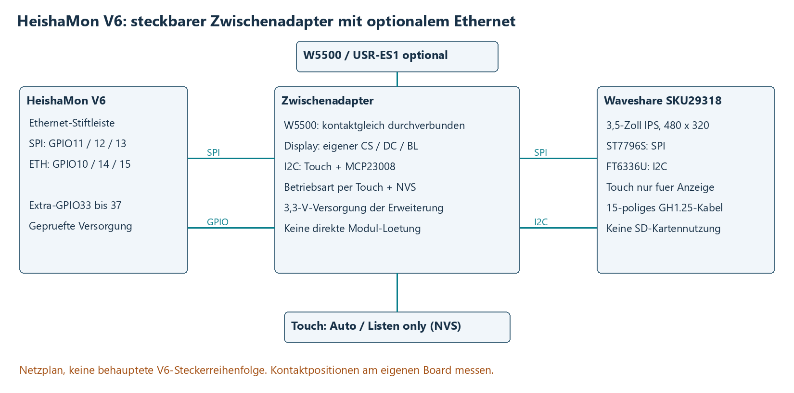

Zusätzlich zu den Funktionsübersichten liegt ein vollständiger KiCad-Schaltplan vor, der alle Verbindungen auf einem A3-Blatt enthält. Er ist zusammen mit der vollständigen Verbindungsmatrix als A3-Anhang am Ende dieser PDF angefügt.

Die Übersicht zeigt elektrische Netze und die geplanten Adapteranschlüsse. **Die Kontaktreihenfolge der originalen V6-Stiftleisten wird bewusst nicht erfunden.** Die Netze am Ethernet-Steckplatz werden vor dem Anschluss per Durchgangsmessung zu den ESP32-S3-Modulanschlüssen identifiziert.

J_ETH_IN und J_ETH_OUT sind Projektbezeichnungen des Zwischenadapters, keine behaupteten Bezeichnungen auf der V6-Platine. Das W5500 wird kontaktgleich durchverbunden. Der Displayabzweig erhält einen eigenen Chip-Select.

## 5. SPI und Extra-GPIOs

| Funktion | ESP32-S3-GPIO / Netz | Verwendung |
| --- | --- | --- |
| Gemeinsamer SPI-Takt | GPIO12 | Ethernet SCK und Display SCLK |
| Gemeinsame Sendedaten | GPIO11 | Ethernet MOSI und Display MOSI |
| SPI-Rückdaten | GPIO13 | Nur Ethernet; Display-MISO bleibt offen |
| Ethernet-CS | GPIO10 | Ausschließlich W5500 |
| Ethernet-Reset | GPIO14 | Unverändert durchverbunden |
| Ethernet-Interrupt | GPIO15 | Unverändert durchverbunden |
| Display-CS | GPIO33 | Eigenständige Geräteauswahl |
| Display-DC | GPIO34 | Unterscheidung Daten / Befehl |
| Displaybeleuchtung | GPIO35 | PWM, 5 kHz, 8 Bit |
| I2C-SDA | GPIO36 | Touch und MCP23008 |
| I2C-SCL | GPIO37 | Touch und MCP23008 |

Die GPIO33-37 werden durch die Erweiterung vor der allgemeinen GPIO-Konfiguration geschützt. Regeln dürfen diese Pins nicht verwenden: Die allgemeine gpio()-Regelfunktion wird in diesem Entwicklungsstand nicht verändert und kann weiterhin direkt auf physische Pins zugreifen.

SPI-Takt des Displays zunächst 8 MHz. Display und Ethernet verwenden dieselbe globale Arduino-SPI-Instanz und getrennte Chip-Selects. Es wird ausdrücklich keine zweite, unabhängige Businstanz auf denselben Leitungen initialisiert.

Das Display wird in Abschnitten von 480 x 4 Pixeln übertragen. Pro Abschnitt wird die SPI-Transaktion beendet, sodass Ethernet dazwischen Zugriff erhält. Ein Renderstreifen enthält zwei Wertezeilen und benötigt einen 480 x 24-Pixel-Puffer, etwa 23 KiB. Ein Vollbildpuffer im RAM wird nicht benötigt.

## 6. Displaystecker: 15-poliger GH1.25-Anschluss

| Displaykontakt | Beschriftung | Verbindung im Entwurf |
| --- | --- | --- |
| 1 | VCC | Geregelte 3,3 V der Erweiterung |
| 2 | 3V3 | Offen; im Entwurf nicht zusätzlich verbinden |
| 3 | GND | Gemeinsame Masse |
| 4 | MISO | Offen, keine Display-Lesezugriffe / keine SD-Karte |
| 5 | MOSI | GPIO11 |
| 6 | SCLK | GPIO12 |
| 7 | SD_CS | 10 kOhm nach 3,3 V, SD bleibt abgewählt |
| 8 | LCD_CS | GPIO33; 10 kOhm Pull-up nach 3,3 V |
| 9 | LCD_DC | GPIO34 |
| 10 | LCD_RST | MCP23008 GP2; 10 kOhm Pull-up |
| 11 | LCD_BL | GPIO35; 100 kOhm Pull-down |
| 12 | TP_SDA | GPIO36 / I2C-SDA |
| 13 | TP_SCL | GPIO37 / I2C-SCL |
| 14 | TP_INT | Offen; Touch wird abgefragt |
| 15 | TP_RST | MCP23008 GP1; 10 kOhm Pull-up |

Die Nummern beziehen sich auf die Waveshare-Dokumentation des 15-poligen Steckers. Vor dem Crimpen die Pin-1-Markierung am realen Display prüfen. Nicht nach Kabelfarben verdrahten. Der 18-polige FPC-Anschluss hat eine andere Belegung und wird hier nicht verwendet.

Waveshare verlangt passende Versorgungs- und Logikpegel. Deshalb ist die gesamte Erweiterung für 3,3-V-Logik und 3,3-V-Displayversorgung geplant. Nicht einfach Display-VCC auf 5 V legen und den Rest unverändert lassen.

## 7. Portexpander, Resetleitungen und passive Bauteile

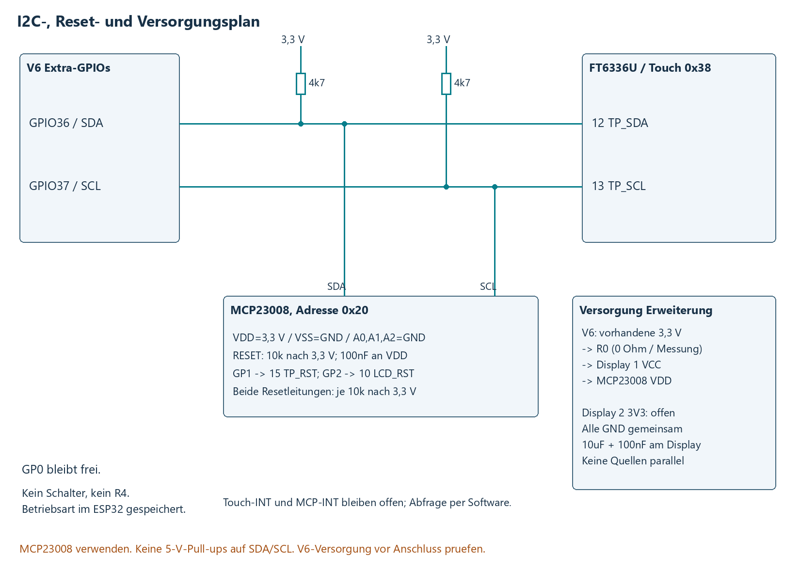

MCP23008 und FT6336U liegen an GPIO36/SDA und GPIO37/SCL. Der Portexpander bleibt nötig, weil die beiden Resetleitungen keine weiteren ESP32-GPIOs belegen sollen. Die Adresspins A0/A1/A2 liegen auf GND; MCP23008-Adresse ist 0x20, Touch-Adresse 0x38.

| Anschluss | Funktion |
| --- | --- |
| GP0 | Frei, keine Betriebsarten-Eingabe |
| GP1 | TP_RST des Displays |
| GP2 | LCD_RST des Displays |
| GP3 bis GP7 | Nicht angeschlossen |
| A0/A1/A2 | GND |
| RESET | 10 kOhm nach 3,3 V |

**Schalter S1, Anschluss J5 und Pull-up R4 entfallen vollständig.** Die Betriebsart wird ausschließlich in der Erweiterungssoftware ausgewählt und gespeichert. R1/R2 bleiben die 4,7-kOhm-I2C-Pull-ups. Vorhandene Pull-ups parallel angeschlossener Module bei der Inbetriebnahme berücksichtigen.

R0 ist die 0-Ohm-Messbrücke der Zusatzversorgung. R3/R5/R6/R7/R10 sind die fünf 10-kOhm-Pull-ups für MCP-Reset, LCD-CS, LCD-Reset, Touch-Reset und SD-CS. R8/R9 mit 33 Ohm dämpfen die SPI-Abzweige zum Display; R11 mit 100 kOhm hält die Beleuchtung beim Start aus. C1/C2 sind 100 nF, C3 ist 10 µF. Die genaue herstellerbezogene Bestückung steht in der JLCPCB-BOM.

## 8. Stromversorgung über die vorhandene V6

Der Entwurf verwendet jetzt die **vorhandene 3,3-V-Versorgung der HeishaMon V6**. Ein zusätzlicher Spannungsregler ist nicht vorgesehen. Die 5-V-Schiene wird auf dem Adapter nur als Reserve und an einem Messpunkt herausgeführt; sie ist nicht mit den 3,3-V-Logiknetzen verbunden.

Die V6 bleibt vollständig für die Erzeugung ihrer Versorgungsspannungen zuständig. Die genaue Reglerbestückung und deren zusätzliche Belastbarkeit wurden ohne V6-Schaltplan nicht verifiziert. Das Vorhandensein eines Schaltreglers allein belegt noch keine bestimmte freie Stromreserve.

Auf dem Adapter liegt zwischen **3V3_V6** und **3V3_EXT** die 0-Ohm-Brücke R0. Dahinter werden ausschließlich Display, MCP23008 und deren Pull-ups versorgt. R0 kann zum Messen des Erweiterungsstroms entfernt und durch ein geeignetes Strommessgerät ersetzt werden. Der W5500 wird unverändert aus der V6 gespeist.

Waveshare nennt für das Display ungefähr 63 mA bei 3,3 V, ohne eindeutige Angaben zu maximaler Beleuchtung und Messbedingungen. Dies ist keine bestätigte Obergrenze. Der USR-ES1-Hersteller fordert eine stabile 3,3-V-Versorgung mit mindestens 200 mA Lieferfähigkeit für das Modul; dies ist ebenfalls kein gemessener Dauerverbrauch.

Vor dem Anschluss sind deshalb zu prüfen:
1. Polarität und Spannungen der tatsächlich vorhandenen V6-Anschlüsse.
2. Zuordnung der Versorgungskontakte am Ethernet-Steckplatz und am zusätzlichen GPIO-/Versorgungsanschluss.
3. Erweiterungsstrom über R0 und Versorgungsspannung während Displaystart, voller Helligkeit und Netzwerkaktivität.
4. Betrieb mit allen geplanten Verbrauchern: Ethernet, Relais, Dallas, gegebenenfalls CZ-TAW1.
5. Temperatur des V6-Reglers und kurzzeitige Spannungseinbrüche; ein Multimeter-Mittelwert allein reicht dafür nicht immer aus.

Es werden **keine zwei unabhängigen 3,3-V- oder 5-V-Quellen parallel verbunden**. Ein alternativer externer Aufbau ist erst nach getrennter Betrachtung der Versorgungspfade vorgesehen. Für den geplanten Normalaufbau genügt die V6-Versorgung, sofern die Reserve am realen Gerät bestätigt wird.

## 9. Betriebsarten, Persistenz und Prioritäten

Die Auswahl ist über **Ansichten → Betriebsart** erreichbar. Alternativ den rechten Kopf-Button kurz antippen. Danach Automatisch oder Listen only antippen. Abbrechen verlässt das Menü ohne Änderung. Der erste Druck auf ein gedimmtes Display weckt zunächst nur die Beleuchtung.

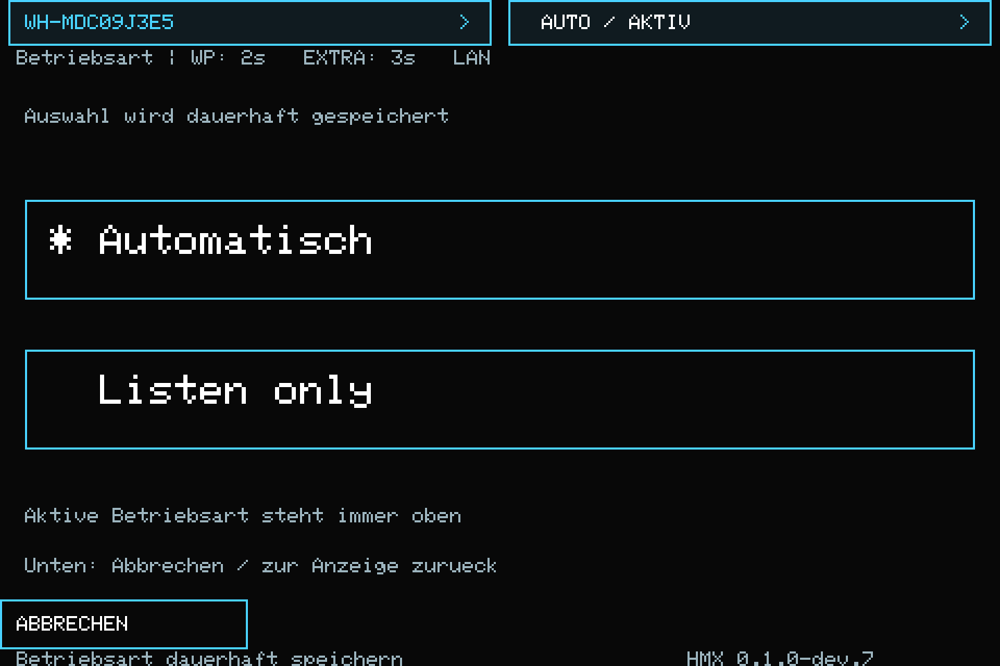

| Zustand | Ergebnis |
| --- | --- |
| Gespeichert: Listen only | Fest passiv, auch nach Neustart |
| Gespeichert: Automatisch; Web-Listen-only aktiv | Passiv durch Web-Konfiguration |
| Automatisch; Empfangsdaten beim Start vorhanden | Passiv durch Startprüfung |
| Automatisch; Web passiv aus; keine Startdaten | Aktiver HeishaMon-Betrieb |
| Portexpander fehlt oder I2C-Lesefehler | Passiv |
| NVS-Speicher kann beim Start nicht geöffnet / gültig gelesen werden | Passiv mit Speicherfehleranzeige |
| Noch kein gespeicherter Wert vorhanden | Automatisch, einschließlich aller bisherigen Prüfungen |
| Wechsel Listen only nach Automatisch | Zunächst 500 ms passiv beobachten |
| Daten während dieser Beobachtung | Passiv verriegelt |
| Keine Daten während der Beobachtung | Aktiv, sofern Web-Konfiguration erlaubt |

Die Auswahl liegt im ESP32-NVS-Namensraum hmx_mode, Schlüssel listen. Sie wird vor der ersten TX-Freigabe geladen. Nur ein tatsächlicher Wechsel löst einen Flash-Schreibvorgang aus; dieselbe gesunde Auswahl erneut zu bestätigen schreibt nicht noch einmal. Ein normales Application-Webupdate erhält die NVS-Partition. Ein vollständiges Flash-Erase entfernt die Auswahl und führt beim folgenden Start wieder zum Standard Automatisch.

Bei einem Schreibfehler bleibt die aktuelle Sitzung passiv und zeigt einen Speicherfehler. Die Auswahl kann erneut gespeichert werden. Für eine fehlgeschlagene Speicherung gibt es keine Neustart-Persistenzgarantie: Nach Neustart gilt der letzte erfolgreich gespeicherte Wert, sofern dieser lesbar ist.

Die Startprüfung erkennt Bytes im UART-Puffer, keine identifizierten Teilnehmer. Auch die erneute 500-ms-Beobachtung ist kein vollständiger Nachweis eines freien Busses. Empfangsbedingtes Listen only bleibt verriegelt, bis per Touch einmal festes Listen only und anschließend wieder Automatisch gewählt oder neu gestartet wird.

Die bestehende Web-Einstellung bleibt getrennt. Sie kann festen Listen-only-Betrieb aus der Touch-Auswahl nicht aufheben. Das Display zeigt den tatsächlich wirksamen Modus; die unveränderte Weboberfläche zeigt ihre eigene Konfiguration.

## 10. Umschalten und Sendetask

Die ESP32-Sendetask und der Betriebsartenwechsel benutzen denselben rekursiven Mutex. Dadurch kann die Umschaltung nicht gleichzeitig mit einem neuen Sendeauftrag erfolgen. Bereits im UART befindliche Bytes werden vor dem Abschalten mit flush() fertig gesendet. Eine begonnene Übertragung wird also nicht mitten im Telegramm abgebrochen.

Bei Zustandswechseln wird die Warteschlange normaler Befehle geleert. Alte, zuvor vorgemerkte Befehle werden nach dem Rückwechsel nicht nachgesendet. Der vorhandene Optional-PCB-Konfigurationszustand wird dadurch nicht gelöscht; dessen periodischer Betrieb wird im aktiven Modus wieder aufgenommen.

Abfrage- und Befehlswege in HeishaMon.ino prüfen den wirksamen passiven Modus. GPIO5 bleibt die vorhandene Freigabe des Sendetreibers. Die Erweiterung schaltet keine Wärmepumpenversorgung und ist kein Not-Aus.

Die Touch-Abfrage läuft etwa alle 30 ms. Betriebsarten- und I2C-Zustände werden etwa alle 20 ms geprüft. Die Reaktionszeit enthält Hauptschleifenlaufzeit, Flash-Schreiben und gegebenenfalls das Fertigsenden eines laufenden Telegramms. Während des Speicherns hält die Erweiterung TX gesperrt.

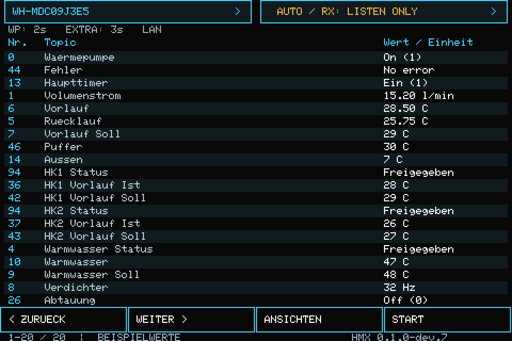

Die Statuszeile zeigt die tatsächlich aktive Betriebsart und deren Ursache: AUTO / AKTIV, AUTO / RX: LISTEN ONLY (beim Start bzw. während der Rückkehr-Prüfung erkannter Fremdverkehr), AUTO / WEB: LISTEN ONLY oder WAHL: LISTEN ONLY. Die RX-Erkennung bleibt bis zu einem Neustart bzw. erneuten Wechsel der Touch-Auswahl verriegelt. Sie ist kein Alarm bei jedem empfangenen Wärmepumpen-Telegramm im aktiven Betrieb.

## 11. Displayansichten

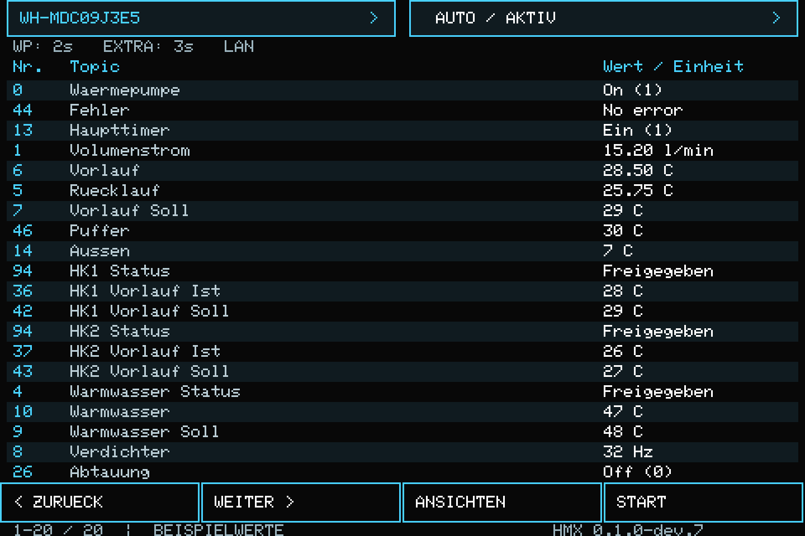

Oben stehen Ansicht, tatsächliche Betriebsart, Datenalter und Netzstatus. In der Mitte stehen bis zu 20 einzeilige Werte in 6x8-Pixel-Schrift mit separater Nummern-, Namens- und Wertspalte. Unten liegen vier Touchflächen: Zurück, Weiter, Ansichten und Start.

| Ansicht | Inhalt |
| --- | --- |
| Übersicht | Vorlauf, Rücklauf, Vorlauf-Soll, HK1/HK2 jeweils Vorlauf-Ist und -Soll, Puffer, Außenluft, Warmwasser Ist/Soll, WW-/HK1-/HK2-Freigabe, Haupttimer, Verdichter, Volumenstrom, Abtauung, Fehler, WP-Zustand |
| Alle WP-Topics | Alle 144 Basis-Topics in Originalreihenfolge |
| Zusatzdaten | Alle 6 XTOP, auch vor dem ersten Empfang sichtbar |
| Optional PCB | Alle 7 OPT |
| Dallas 1-Wire | Alle bekannten Sensoren aus dem aktivierten Dallas-Modul |
| Wertdetails | Voller Topicname / ID, Wert und Datenalter |

Der Umfang wird nicht auf 143 festgeschrieben. Die Firmware liest NUMBER_OF_TOPICS, NUMBER_OF_TOPICS_EXTRA und NUMBER_OF_OPT_TOPICS des jeweiligen Upstream-Stands. Der jetzige Stand besitzt 144 Basis-Topics, also TOP0 bis TOP143. Eine erweiterte Upstream-Tabelle wächst damit automatisch in der Liste mit.

Reihenfolge ab dev.6: WP-Zustand (0), Fehler (44), Haupttimer (13), Volumenstrom (1), Vorlauf (6), Rücklauf (5), Vorlauf-Soll (7), Puffer (46), Außen (14), HK1 Status/Ist/Soll (94/36/42), HK2 Status/Ist/Soll (94/37/43), WW Status/Ist/Soll (4/10/9), Verdichter (8), Abtauung (26). Volumenstrom wird einmal angezeigt.

Die Übersicht enthält jetzt 20 Werte auf einer Seite; es bleiben keine freien Datenzeilen. HK1 zeigt TOP36 (Z1_Water_Temp) und TOP42 (Z1_Water_Target_Temp), HK2 TOP37 und TOP43, Puffer TOP46 (Buffer_Temp). Es werden die von HeishaMon gelieferten Werte angezeigt; deren Verfügbarkeit hängt von Modell, Sensoren und Konfiguration ab.

**Ergänzungen ab dev.5:** Warmwasser-Soll (9), Warmwasser-Status (4), HK1- und HK2-Status (jeweils 94) sowie Haupttimer (13). Die Statuszeilen sind aus den vorhandenen Topics abgeleitet: WW aus Betriebsart (4) und WP Ein/Aus (0), HK1/HK2 zusätzlich aus der Zonenauswahl (94). Die Nummernspalte zeigt die primäre Topic-Nummer, in der Detailansicht stehen alle verwendeten Quellen.

**Freigegeben** bedeutet, dass die WP eingeschaltet und der jeweilige Bereich in Betriebsart bzw. Zonenauswahl ausgewählt ist. Das ist keine Aussage über aktuellen Wärmebedarf, laufende Zonenpumpen oder tatsächliche Warmwasserbereitung. Im reinen WW-Modus sind beide HK-Status Aus; bei ausgeschalteter WP sind alle drei Status Aus. Ungültige Quellwerte ergeben Unbekannt, fehlende Telegramme keine Daten; veraltete Daten behalten die Warnfarbe.

**Haupttimer Ein (1) / Aus** zeigt ausschließlich TOP13 Main_Schedule_State: Wochenprogramm eingeschaltet oder ausgeschaltet. Daraus sind keine einzelnen Schaltzeiten, nächsten Schaltpunkte oder getrennten Timer für WW/HK1/HK2 ableitbar. Quiet_Mode_Schedule (3) und Holiday_Mode_State (19) bleiben in der vollständigen Topic-Liste verfügbar.

Diese erste Umsetzung gruppiert nach Datenquelle. Eine zusätzliche fachliche Unterteilung aller Basis-Topics, etwa in Verdichter oder Heizkreis, ist noch nicht implementiert. Die vollständige Liste und die Übersicht stehen bereits zur Verfügung.

### Modellanzeige und Geräteinfo ab dev.7

Der linke Kopf-Button zeigt das aus TOP92 zugeordnete Außengerät in 6x8-Schrift; bei Monoblock-Geräten deren Typbezeichnung. Kurzes Antippen öffnet die Geräteinfo. Der rechte Kopf-Button zeigt weiterhin die tatsächlich aktive Kommunikationsbetriebsart und öffnet durch kurzes Antippen die Auswahl Automatisch/Listen only. Die Auswahl wird erst im Menü geändert und gespeichert. Es ist kein langer Druck mehr nötig. Die 20 Datenzeilen der Standardansicht bleiben erhalten. In anderen Ansichten steht deren Titel in der zweiten Kopfzeile.

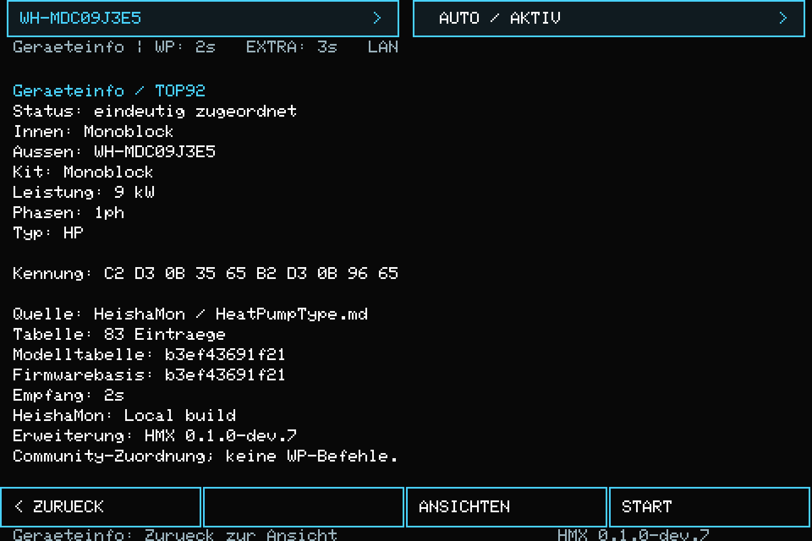

Die Geräteinfo zeigt Innen-/Außengerät, Kit, Leistung, Phasen, Ausführung, die unveränderte 10-Byte-Rohkennung und den Quellenstand. Außerdem stehen dort HeishaMon-Versionsstring, Firmwarebasis-Commit und HMX-Erweiterungsversion getrennt. Die unveränderte version.h unserer HeishaMon-Basis enthält Local build; es wird deshalb keine Release-Nummer erfunden. Die Fußzeile zeigt weiterhin HMX 0.1.0-dev.7.

Der Tabellen-Snapshot enthält 83 Einträge aus HeatPumpType.md, festgehalten auf Upstream-Commit b3ef43691f21985c851903d69a0f2e8647ed31f8. Kein Internetzugriff zur Laufzeit. Bei fehlenden Telegrammen erscheint Modell: keine Daten, bei unbekannter Kennung Modell unbekannt, bei mehreren exakten Treffern Modell mehrdeutig. Ungültige Kennungen werden separat benannt. Es wird nie anhand ähnlicher Bytes geraten. Die Geräteinfo behält die Rohkennung auch dann bei.

Zurück führt zur zuvor geöffneten Ansicht und Seite, auch wenn die Geräteinfo aus einer Topic-Detailansicht geöffnet wurde. Der erste Druck nach dem Dimmen weckt weiterhin nur die Beleuchtung. Beide Kopf-Touchbereiche umfassen 24 Pixel Höhe und je eine Displayhälfte.

Die Zuordnung ist nur eine lokale Displayfunktion: HeishaMon decode.cpp, MQTT und JSON geben TOP92 weiterhin unverändert aus. Die Konstantentabelle liegt getrennt in extension/hmx_model_data.h; der Parser in extension/hmx_model.h. Sie ist in dev.7 kompiliert und noch nicht als separate Laufzeit-Datei austauschbar.

### Modelltabelle bei späteren Updates erneuern

1. Die neue HeatPumpType.md aus dem geprüften offiziellen Upstream-Commit nach upstream-reference/HeatPumpType.md übernehmen.
2. Generator mit dem tatsächlichen Commit ausführen:

```powershell
python tools/update_model_table.py --commit TATSAECHLICHER_UPSTREAM_COMMIT
python tools/update_model_table.py --commit TATSAECHLICHER_UPSTREAM_COMMIT --check
```

TATSAECHLICHER_UPSTREAM_COMMIT durch die überprüfte vollständige Commit-Kennung ersetzen. Der Generator akzeptiert alternativ --source mit einem anderen lokalen Dateipfad. Er prüft 10 Kennungsbytes pro Zeile und eindeutige Tabellen-IDs; doppelte Signaturen werden im Katalog ausgewiesen und von der Anzeige als mehrdeutig behandelt. Er erzeugt die C++-Tabelle und docs/model_catalogue.json gemeinsam.

3. Änderungen prüfen, Integrationsdateien synchronisieren, Tests und neuen ESP32-Build ausführen. Ein bloßer Austausch der Markdown-Datei auf der SD-Karte oder im ESP aktualisiert die kompilierte Tabelle nicht. Die Integration nimmt neue Module über tools/apply_extension.py mit; veränderte installierte Dateien werden weiterhin nicht ungeprüft überschrieben.
4. Wenn sich die Firmwarebasis ändert, HMX_UPSTREAM_COMMIT in hmx_config.h auf den tatsächlich integrierten Basisstand setzen. Der Commit der Modelltabelle wird unabhängig davon vom Generator eingetragen.

## 12. Touchbedienung und Datenqualität

- Kurzer Druck auf Zurück / Weiter blättert um 20 Werte.
- Gedrückthalten wiederholt nach etwa 600 ms und danach alle 200 ms.
- Ansichten öffnet die Auswahl der fünf Datenquellen.
- Start führt zur Übersicht.
- Linker Kopf-Button: Geräteinfo; rechter Kopf-Button: Betriebsartenmenü, jeweils kurzer Druck.
- Antippen einer Wertezeile öffnet die Detailansicht.
- Zurück in der Detailansicht führt zur vorherigen Liste.
- Wischgesten sind in dieser ersten Version nicht implementiert.

Nach 60 Sekunden ohne neue Bedienung dimmt die Beleuchtung auf den konfigurierten Wert. Der erste Druck nach dem Dimmen weckt nur auf, ohne die Ansicht zu wechseln.

Vor dem ersten gültigen Telegramm erscheint "keine Daten". Basis-, Zusatz- und Optionaldaten besitzen getrennte Empfangszeitstempel. Auch ein gültiges Telegramm mit unveränderten Messwerten aktualisiert den Zeitstempel. Nach 30 Sekunden ohne entsprechenden Empfang wird die Darstellung als veraltet markiert. Bei abweichenden Abfrageintervallen HMX_STALE_MS passend wählen.

Dallas zeigt Alias oder Sensor-ID. Werte ohne bestätigte lokale Messung erscheinen als "keine Daten", auch wenn MQTT einen alten Wert zurückgeliefert hat. Nicht erreichbare Sensoren werden als OFFLINE gekennzeichnet.

Bei neueren Modellen werden die bekannten alten Leistungs-Topics auf der Anzeige mit "XTOP nutzen" ersetzt, sobald der Originaldatenblock das entsprechende Modellmerkmal enthält. Zusatzwerte bleiben bis zum Empfang unbekannt. Es erfolgt keine erfundene Leistungsschätzung und keine automatische COP-Berechnung.

Die 6x8-Schrift ist die klassische Adafruit-GFX-Bitmap-Schrift. Bei 480 Pixeln Breite passen die derzeitigen Basis-Topicnamen vollständig in die Namensspalte. Nur die Nummer wird angezeigt, ohne TOP-/XTOP-/OPT-Präfix; die Datenquelle steht in der Ansichtsüberschrift. Dallas erhält eine laufende Nummer und behält seine Sensor-ID in den Details.

Die Firmware-Schrift ist eine einfache ASCII-Schrift. Deutsche Beschriftungen verwenden deshalb ae/oe/ue. Unbekannte Sonderzeichen werden ersetzt; lange Zeilen werden gekürzt und sind über Details aufrufbar.

## 13. Erstinbetriebnahme ohne V6-Schaltplan

1. HeishaMon spannungsfrei machen. Ethernetmodul abziehen.
2. Die sechs Ethernet-Signalnetze GPIO10-15 durch Durchgangsmessung identifizieren und die eigene Kontaktliste notieren. Versorgungspins unabhängig davon messen und beschriften.
3. Extra-GPIOs33-37 an der Erweiterungsleiste identifizieren. Keine Steckerorientierung anhand eines Fotos anderer Revisionen übernehmen.
4. Zwischenadapter zunächst ohne W5500 aufbauen. Jede Durchleitung prüfen, benachbarte Kontakte auf Kurzschluss prüfen.
5. MCP23008, Pull-ups und V6-Versorgung über R0 anschließen. Display noch abgesteckt lassen.
6. Versorgung prüfen: 3,3 V an MCP und am vorgesehenen Display-VCC, keine 5-V-Pull-ups an I2C.
7. Display anschließen. Zunächst die Wärmepumpen-Datenleitung getrennt lassen und über die geprüfte V6-Versorgung testen.
8. Erst nach erfolgreichem echten Firmware-Build die Erweiterungsfirmware aufspielen.
9. Prüfen, ob I2C-Adressen 0x20 und 0x38 erreichbar sind. Über das Touch-Menü Listen only wählen; die Kopfzeile muss dies bestätigen.
10. Farben, Bildlage und die vier Touch-Ecken testen. Achsen bei Bedarf in hmx_config.h ändern.
11. Mit getrennten WP-Datenleitungen Touch-Betriebsartenwahl, Speicherverhalten und Neustart durchführen und GPIO5 beziehungsweise den Pegelwandler-Ausgang messen.
12. Erst danach WP anschließen und passive Datenanzeige prüfen.
13. Aktiven Automatikbetrieb nur mit passender Teilnehmerkonfiguration testen.
14. Zum Schluss W5500 einsetzen und Netzwerk plus Display zusammen testen.

Die Pinidentifikation ist eine vorgesehene Aufgabe am realen Gerät. Der fehlende V6-Schaltplan blockiert den Prototyp nicht; er wird durch Messung und dokumentierte Anschlusszuordnung ersetzt.

## 14. Firmware bauen: Windows CLI, Arduino IDE oder GitHub Actions

### 14.1 Welcher Weg ist gemeint?

Der bestehende lokale Build verwendet Arduino CLI, nicht die grafische Arduino IDE. CLI und IDE verwenden den ESP32-Arduino-Core samt Compiler. GitHub Actions führt den CLI-Build auf einem Linux-Rechner bei GitHub aus. Alle drei Wege erzeugen eine Application-BIN; deren Installation erfolgt danach über das vorhandene HeishaMon-Webinterface.

| Weg | Auf dem eigenen Rechner benötigt | Ergebnis |
| --- | --- | --- |
| Windows / Arduino CLI | Python 3, Node.js LTS, Arduino CLI | Benannte BIN in output/firmware |
| Arduino IDE 2 | Arduino IDE, Bibliotheken; Python für das beiliegende Paketierungsskript | Exportierte BIN, anschließend mit MD5 benannt |
| GitHub Actions | GitHub-Konto, Browser; GitHub Desktop für den Projekt-Upload | Download-Artefakt mit BIN und Manifest |

Zum Kompilieren und Exportieren muss die V6 nicht per USB angeschlossen sein. Ein Port wird erst beim seriellen Hochladen benötigt; hier wird anschließend das Webinterface benutzt. Die IDE-Schaltfläche Hochladen ist daher nicht Teil dieses Ablaufs.

**Stand dieser Anleitung:** dev.7 enthält die neue Modellanzeige und Kopf-Schaltflächen. Der vollständige Buildversuch vom 26.10.2026 erkennt ESP32-Core 3.3.12, scheitert aber in der Agent-Ausführungsumgebung beim Compilerstart mit dem bekannten DLL-Fehler. dev.7 muss daher noch außerhalb dieser Umgebung neu gebaut werden. Der vorangegangene dev.6-Stand wurde vom Anwender erfolgreich mit Core 4.0.0-alpha1 gebaut; diese alte BIN enthält die neue Modellanzeige noch nicht. IDE-, Actions- und Hardwaretests von dev.7 sind nicht nachgewiesen.

### 14.2 Gemeinsame Vorbereitung und richtige Dateien

1. Das vollständige Projekt-ZIP in einen eigenen Ordner entpacken, zum Beispiel D:\ChatGPT_CODEX\HeishaMon. Nicht direkt innerhalb des ZIP arbeiten.
2. In diesem Hauptordner müssen README.md und die Unterordner firmware, extension, tools, tests, vendor und upstream-reference nebeneinander liegen.
3. Der zu bauende Sketch ist firmware/HeishaMon/HeishaMon.ino. Die Erweiterung ist dort bereits integriert. Nicht nur die Dateien aus extension einzeln in der IDE öffnen.
4. Eigene Hardwareparameter stehen in extension/hmx_config.h. Bei Änderungen an der Erweiterung müssen die installierten Dateien kontrolliert synchronisiert werden; das Integrationsskript überschreibt absichtlich keine abweichende Installation.
5. Für die folgenden PowerShell-Befehle im Explorer den Projekt-Hauptordner öffnen, in die Adresszeile powershell eingeben und Enter drücken. Mit den folgenden Befehlen den Arbeitsordner prüfen:

```powershell
Get-Location
Test-Path .\tools\build.ps1
Test-Path .\firmware\HeishaMon\HeishaMon.ino
```

Beide Test-Path-Ausgaben müssen True sein. Bei False den Ordner mit README.md öffnen und dort ein neues Terminal starten. Befehle einzeln ausführen und nach einer Fehlermeldung zunächst deren Ursache beheben.

Für alle drei Wege gelten dieselben Zielparameter:

| Parameter | Einstellung |
| --- | --- |
| Zielboard | ESP32S3 Dev Module, Kennung esp32:esp32:esp32s3 |
| ESP32-Core | esp32 by Espressif Systems, Version 3.3.12 |
| USB CDC On Boot | Enabled; CLI: CDCOnBoot=cdc |
| PSRAM | QSPI PSRAM; CLI: PSRAM=enabled |
| Partition Scheme | Minimal SPIFFS mit OTA; CLI: PartitionScheme=min_spiffs |
| Flash Size | 4 MB entsprechend der hier verwendeten Build-Konfiguration |
| Sonstige Boardoptionen | Voreinstellungen dieses Boards/Core-Stands |

Zielboard, USB CDC, QSPI-PSRAM und Partitionierung entsprechen dem offiziellen HeishaMon-S3-Buildskript. Für den nächsten lokalen Build und die beiliegende CI-Vorlage ist Core 3.3.12 vorgesehen. PSRAM=enabled heißt beim S3 konkret QSPI PSRAM, nicht OPI. Andere Modulvarianten müssen vor einer Abweichung anhand ihrer Hardware geprüft werden. Die reale Partitionstabelle der vorhandenen V6 wurde hier nicht ausgelesen.

### 14.3 Weg A: Windows mit Arduino CLI - einmalige Einrichtung

**Python installieren:** Auf https://www.python.org/downloads/windows/ einen regulären Python-3-Installer für Windows auswählen. Im klassischen Installer die Option Add python.exe to PATH aktivieren. Alternativ den offiziellen Python Install Manager verwenden. Danach ein neues PowerShell-Fenster öffnen:

```powershell
python --version
```

Erwartet wird Python 3.x. Falls stattdessen der Microsoft Store geöffnet wird, Python-Installation und Windows-App-Ausführungsalias prüfen. Funktioniert auf dem Rechner nur py -3, in allen folgenden Python-Befehlen python durch py -3 ersetzen. Für Integration und Firmware-Paketierung sind keine zusätzlichen pip-Pakete nötig.

**Node.js installieren:** Auf https://nodejs.org/en/download die Windows-LTS-Version installieren und anschließend ein neues Terminal öffnen:

```powershell
node --version
```

Erwartet wird eine Versionsnummer. Node.js wird für den Test der HTML-Displayvorschau gebraucht; es kompiliert nicht die Firmware.

**Arduino CLI installieren:** Auf https://docs.arduino.cc/arduino-cli/installation/ unter Download die passende Windows-Version laden. arduino-cli.exe zum Beispiel nach C:\Tools\ArduinoCLI entpacken. Diesen Ordner über Windows-Suche Umgebungsvariablen bearbeiten > Benutzervariablen > Path > Bearbeiten > Neu hinzufügen. Vorhandene PATH-Einträge beibehalten. Danach PowerShell neu öffnen:

```powershell
arduino-cli version
```

Erwartet wird die CLI-Version. Eine installierte Arduino IDE ersetzt diesen PATH-Schritt nicht automatisch. Als Alternative unterstützt tools/build.ps1 den Parameter -ArduinoCli mit dem vollständigen EXE-Pfad.

**ESP32-Core und Bibliotheken installieren:** Bei Internetzugriff nacheinander im Projekt-Hauptordner ausführen:

```powershell
$espIndex='https://espressif.github.io/arduino-esp32/package_esp32_index.json'
arduino-cli core update-index --additional-urls $espIndex
arduino-cli core install esp32:esp32@3.3.12 --additional-urls $espIndex
arduino-cli lib update-index
arduino-cli lib install "RingBuffer@1.0.5" "PubSubClient@2.8"
arduino-cli lib install "ArduinoJson@7.4.2" "DallasTemperature@4.0.5"
arduino-cli lib install "OneWire@2.3.8" "Adafruit GFX Library@1.12.4"
arduino-cli lib install "Adafruit BusIO"
arduino-cli core list
arduino-cli lib list
```

Erwartet wird der Core esp32:esp32 in Version 3.3.12 und die genannten Bibliotheken. Adafruit NeoPixel 1.15.5 liegt bereits unter vendor/Adafruit_NeoPixel und wird vom Buildskript über --library vendor/Adafruit_NeoPixel eingebunden. vendor/DisplayFont dient der Vorschauerzeugung und wird nicht als zusätzliche Arduino-Bibliothek installiert. Keine zusätzlichen Displaytreiber wie TFT_eSPI oder LVGL nötig.

Erste Downloads und erster Build können mehrere Minuten dauern. Die spätere Kompilierung nutzt lokale Caches. Die hier genannten Versionen entsprechen der beigefügten Workflow-Vorlage; ein Versionswechsel wird nicht automatisch als kompatibel angenommen.

### 14.4 Weg A: prüfen, bauen und BIN finden

Im Projekt-Hauptordner:

```powershell
python tools/apply_extension.py firmware --check
python tests/test_integration.py
node tests/test_preview.mjs
powershell -NoProfile -ExecutionPolicy Bypass -File .\tools\build.ps1
```

Erwartete Ergebnisse: Die Integrationsprüfung meldet HMX already installed; all tracked hashes match. Die Python-Tests melden sechs erfolgreiche Tests und OK. Der Vorschautest endet mit seiner OK-Meldung. Erst nach erfolgreicher Kompilierung gibt das Buildskript Web-Update: und den Pfad zur benannten BIN aus.

ExecutionPolicy Bypass gilt hier nur für diesen PowerShell-Aufruf. Es wird keine dauerhafte Ausführungsrichtlinie geändert.

Ergebnisordner: output/firmware. Die relevante Datei heißt HeishaMon_ESP32-HMX-0.1.0-dev.7-<md5>.bin. Die spitzen Klammern stehen für die tatsächliche 32-stellige MD5-Prüfsumme und werden nicht mitgetippt. Das Skript prüft die Größe und benennt nur nach einem erfolgreichen Compiler-Aufruf eine Application-BIN.

Optional zusätzlich das Firmware-Manifest erzeugen:

```powershell
python tools/package_firmware.py output/firmware
```

Dieses Skript erwartet eine vorhandene HeishaMon.ino.bin, prüft deren Magic-Byte und Größe, erzeugt die benannte Kopie sowie firmware_manifest.json mit MD5 und SHA256. Es kompiliert selbst nicht.

Alternative, wenn arduino-cli.exe nicht im PATH liegt:

```powershell
$cli='C:\Tools\ArduinoCLI\arduino-cli.exe'
powershell -NoProfile -ExecutionPolicy Bypass -File .\tools\build.ps1 -ArduinoCli $cli
```

Die Einrichtungsschritte davor ebenfalls mit diesem EXE-Pfad aufrufen, zum Beispiel & $cli version. Falls CLI eine eigene YAML-Konfiguration braucht, unterstützt build.ps1 zusätzlich -ConfigFile mit deren Pfad. IDE und CLI können unterschiedliche Daten- und Bibliotheksordner verwenden; bei fehlenden Bibliotheken arduino-cli config dump kontrollieren.

### 14.5 Weg B: Arduino IDE 2 einrichten

1. Arduino IDE 2 von https://www.arduino.cc/en/software/ installieren und öffnen.
2. Datei > Voreinstellungen / File > Preferences öffnen. Bei Zusätzliche Boardverwalter-URLs die folgende URL als weiteren Eintrag ergänzen. Vorhandene URLs beibehalten:

```text
https://espressif.github.io/arduino-esp32/package_esp32_index.json
```

3. Den Boardverwalter / Boards Manager öffnen. Nach esp32 suchen, esp32 by Espressif Systems auswählen und Version 3.3.12 installieren.
4. Unter Werkzeuge > Board / Tools > Board das ESP32S3 Dev Module auswählen.
5. Unter Werkzeuge die Einstellungen aus der Tabelle in 14.2 setzen: USB CDC Enabled, PSRAM QSPI PSRAM, Flash Size 4MB und Minimal SPIFFS mit OTA. Je nach Core-Version enthält der Menütext eine gerundete App-/SPIFFS-Größe; entscheidend ist die Option min_spiffs. Nicht Huge APP oder ein Schema ohne OTA wählen.
6. Über den Bibliotheksverwalter / Library Manager die Bibliotheken aus folgender Tabelle installieren. Falls eine Versionsauswahl angeboten wird, die angegebene Version nehmen. Erforderliche Abhängigkeiten, insbesondere Adafruit BusIO, mitinstallieren.

| Bibliothek | Version / Herkunft |
| --- | --- |
| RingBuffer | 1.0.5 |
| PubSubClient | 2.8 |
| ArduinoJson | 7.4.2 |
| DallasTemperature | 4.0.5 |
| OneWire | 2.3.8 |
| Adafruit GFX Library | 1.12.4 |
| Adafruit BusIO | Über Bibliotheksverwalter / Abhängigkeitsdialog |
| Adafruit NeoPixel | 1.15.5; dieselbe Version wie im Projekt-vendor |

Die IDE übernimmt --library vendor/Adafruit_NeoPixel aus dem PowerShell-Skript nicht. Deshalb NeoPixel hier ausdrücklich installieren. Falls diese Version im Manager nicht verfügbar ist, bei geschlossener IDE den kompletten Ordner vendor/Adafruit_NeoPixel nach <Sketchbook>/libraries/Adafruit_NeoPixel kopieren. Den Sketchbook-Pfad zeigt Datei > Voreinstellungen. Vorhandene Bibliotheken nicht ungeprüft überschreiben; doppelte NeoPixel-Installationen zuerst vergleichen. Anschließend IDE neu starten.

7. Datei > Öffnen und firmware/HeishaMon/HeishaMon.ino auswählen. Alle zum Sketch gehörenden Dateien bleiben im mitgelieferten Ordner, einschließlich src/hmx.
8. Optional in Voreinstellungen die ausführliche Ausgabe beim Kompilieren einschalten. Das erleichtert die Prüfung verwendeter Bibliotheksversionen und die Fehlersuche.

### 14.6 Weg B: in der IDE kompilieren, exportieren und benennen

1. Zunächst Überprüfen / Verify (Häkchen) wählen. Die IDE muss ohne Compilerfehler abschließen. Ein erfolgreiches Verify allein erzeugt noch keine zuverlässig auffindbare Exportdatei für diesen Ablauf.
2. Sketch > Kompilierte Binärdatei exportieren / Sketch > Export Compiled Binary wählen. Der Sketch wird gegebenenfalls erneut gebaut.
3. Über Sketch > Sketch-Ordner anzeigen / Show Sketch Folder den Ordner firmware/HeishaMon öffnen. Die ESP32-IDE-2-Ausgabe liegt üblicherweise darunter in build/esp32.esp32.esp32s3. Falls abweichend, nach der gerade erzeugten HeishaMon.ino.bin suchen und Zeitstempel kontrollieren.
4. Ausschließlich die Application-Datei HeishaMon.ino.bin verwenden. Nicht HeishaMon.ino.bootloader.bin, HeishaMon.ino.partitions.bin, eine merged.bin oder eine with_bootloader-Datei.
5. Zur Größenprüfung, MD5-Benennung und Erzeugung des Manifests das beiliegende Paketierungsskript benutzen. Dazu Python wie in 14.3 einrichten und im Projekt-Hauptordner den tatsächlich vorhandenen Exportordner angeben:

```powershell
$exportDir='firmware/HeishaMon/build/esp32.esp32.esp32s3'
Test-Path (Join-Path $exportDir 'HeishaMon.ino.bin')
python tools/package_firmware.py $exportDir
```

Test-Path muss True liefern. Bei False den Exportordner anpassen und nicht mit einer zufällig noch vorhandenen alten BIN weiterarbeiten. Das Skript schreibt die benannte HeishaMon_ESP32-HMX-0.1.0-dev.7-<md5>.bin und firmware_manifest.json direkt in diesen Exportordner.

Die IDE meldet eventuell nur, dass das Programm in den regulären App-Slot passt. Für den vorhandenen Web-Updater ist zusätzlich die konservative Grenze 0x1DF000 Byte einzuhalten; das Paketierungsskript prüft genau diese Grenze.

Die IDE führt die Python-Integrations- und Node-Vorschautests nicht automatisch aus. Diese bei vorhandenen Werkzeugen wie in 14.4 separat ausführen. Ein erfolgreicher IDE-Build ersetzt keine Hardware-Funktionsprüfung.

### 14.7 Weg C: GitHub Actions ohne lokalen ESP32-Compiler

Hier kompiliert GitHub auf Linux. Auf dem eigenen Rechner werden weder ESP32-Compiler noch Arduino CLI oder IDE benötigt. Die Vorlage liegt unter tools/HMX_build_workflow.yml; sie wird nicht automatisch durch das Herunterladen des Projekt-ZIP aktiv. Es wird ein eigenes Repository mit Schreibzugriff benötigt.

**Eigenes Repository mit GitHub Desktop vorbereiten:**

1. GitHub-Konto anlegen beziehungsweise anmelden. GitHub Desktop von https://desktop.github.com/ installieren und dort anmelden.
2. Eine Arbeitskopie des entpackten Projektordners verwenden. In deren Hauptordner liegt die mitgelieferte .gitignore. Im Explorer unter Ansicht die Anzeige ausgeblendeter Elemente aktivieren, falls die Datei nicht sichtbar ist.
3. In GitHub Desktop File > Add local repository wählen und genau diesen Hauptordner auswählen. Falls er noch kein Git-Repository ist, den angebotenen Link create a repository here verwenden. Vor dem Bestätigen den endgültigen Pfad kontrollieren, damit kein zusätzlicher gleichnamiger Unterordner entsteht.
4. Die Vorlage im Projektordner an den für GitHub erforderlichen Ort kopieren. Dazu PowerShell im Hauptordner öffnen:

```powershell
New-Item -ItemType Directory -Force .github\workflows | Out-Null
Copy-Item .\tools\HMX_build_workflow.yml .\.github\workflows\hmx-build.yml
Test-Path .\.github\workflows\hmx-build.yml
```

5. Zurück in GitHub Desktop die Änderungen prüfen und als ersten Commit speichern, beispielsweise mit der Zusammenfassung HeishaMon Touch Build vorbereiten.
6. Publish repository wählen. Einen eigenen Namen vergeben, zum Beispiel HeishaMon-Touch. Private Veröffentlichung ist möglich; dann Keep this code private aktiviert lassen. Aktionen und mögliche Kontingente richten sich nach dem GitHub-Konto. Anschließend Repository veröffentlichen.
7. Im Browser im Repository prüfen, ob firmware/HeishaMon/HeishaMon.ino, vendor/Adafruit_NeoPixel, tools, tests und upstream-reference tatsächlich vorhanden sind. Die Ordner dürfen nicht versehentlich in einer zusätzlichen ZIP-Verzeichnisebene liegen.
8. Unter .github/workflows muss hmx-build.yml auf dem Standardbranch, üblicherweise main, sichtbar sein. output und archive sind durch .gitignore absichtlich vom Repository ausgeschlossen.

Ein einfacher Fork des unveränderten offiziellen HeishaMon reicht nicht aus: Der Workflow benötigt unser vollständiges Projekt mit integrierter Erweiterung, Prüfdateien und vendor-Inhalt. GitHub Desktop benötigt für diesen Ablauf keinen zusätzlichen lokalen Git-CLI-Aufruf.

**Build starten und verfolgen:**

1. Im eigenen Repository den Reiter Actions öffnen.
2. Falls GitHub eine Aktivierung der Workflows verlangt, diese im eigenen Repository freigeben. Bei organisationsseitiger Sperre sind die Repository-/Organisationsregeln maßgeblich.
3. Links HMX ESP32-S3 build auswählen.
4. Run workflow anklicken, den Standardbranch auswählen und mit Run workflow starten. Der Workflow muss für diesen Knopf auf dem Standardbranch liegen und workflow_dispatch enthalten; beides ist mit der genannten Einrichtung vorgesehen.
5. Den neu angelegten Lauf öffnen. Der Job build prüft Python-/C++-Regressionsfälle und Integration, installiert Core/Bibliotheken, kompiliert den Sketch und paketiert die BIN. Die dev.7-Vorlage prüft zusätzlich Modellzuordnung, Tabellenreproduktion und HTML-Vorschau.
6. Erst bei grünem Abschluss mit dem Download fortfahren. Ein roter Schritt bedeutet: dessen Protokoll öffnen, Fehlermeldung beheben, Änderung committen und Push origin ausführen. Danach einen neuen Lauf starten. Ein grüner Build ist ein Compiler-Nachweis, kein Nachweis erfolgreicher Hardwaretests.

Die Vorlage startet außerdem bei Pushes mit Änderungen unter extension, firmware, tools oder tests. Der manuelle Start bleibt möglich. Ein Workflow-Lauf veröffentlicht die Firmware nicht automatisch als GitHub Release und installiert nichts auf der V6.

**Fertige BIN herunterladen:**

1. Auf der Übersichtsseite des erfolgreichen Laufs zum Abschnitt Artifacts scrollen.
2. HeishaMon-HMX-ESP32S3-development anklicken. Zum Download bei GitHub angemeldet sein.
3. Das heruntergeladene ZIP entpacken. Darin müssen die benannte HeishaMon_ESP32-HMX-0.1.0-dev.7-<md5>.bin und firmware_manifest.json enthalten sein. Eventuelle Unterordner mit öffnen.
4. Im Manifest Ziel ESP32-S3, Erweiterungsversion, Dateigröße und MD5 prüfen. Das Feld hardware_tested bleibt false, solange kein separater Hardwaretest dokumentiert ist.
5. Die benannte BIN lokal aufbewahren und mit Kapitel 15 fortfahren. Das Artefakt-ZIP selbst nicht im HeishaMon hochladen.

Falls kein Run-workflow-Knopf erscheint: Standardbranch, Dateipfad .github/workflows/..., workflow_dispatch und Schreibrechte prüfen. Falls Artifacts fehlt: erfolgreichen Abschluss des Upload-artifact-Schritts prüfen. Artefakte können ablaufen; benötigte BIN und Manifest rechtzeitig lokal sichern.

### 14.8 BIN prüfen und typische Fehler unterscheiden

Für alle Wege gilt: Nur die BIN des letzten tatsächlich erfolgreichen Builds verwenden. Nach einem fehlgeschlagenen Build können alte Dateien im Ausgabeordner liegen. Zeitstempel, Versionsangabe, Buildprotokoll und gegebenenfalls Manifest zusammen betrachten.

```powershell
$image=Get-ChildItem .\output\firmware\HeishaMon_ESP32-HMX-*.bin
$image | Select-Object Name,Length,LastWriteTime
```

Dieser Ordner gilt für den CLI-Weg. Beim IDE-Weg den Exportordner und beim Actions-Weg den entpackten Downloadordner verwenden. Falls mehrere BINs vorhanden sind, die zum ausgewählten erfolgreichen Build gehörende Datei gezielt bestimmen. MD5 für eine konkret ausgewählte Datei:

```powershell
$bin='D:\Pfad\Zur\ausgewaehlten.bin'
Get-FileHash -LiteralPath $bin -Algorithm MD5
```

Die tatsächliche Prüfsumme muss mit dem Dateinamen beziehungsweise Manifest übereinstimmen. Die Dateigröße darf 0x1DF000 Byte, also 1.961.984 Byte, nicht überschreiten. Die Build- und Paketierungsskripte brechen bei Übergröße ab. Ein normales Application-Update ändert keine Partitionstabelle.

| Meldung / Situation | Nächster Schritt |
| --- | --- |
| python, node oder arduino-cli nicht gefunden | Installation und PATH kontrollieren; neues Terminal öffnen |
| Datei oder Sketch nicht gefunden | Hauptordner und Test-Path aus 14.2 prüfen |
| Header/Bibliothek fehlt | Genannte Bibliothek im verwendeten CLI-/IDE-Profil installieren; vendor bei CLI mitnehmen |
| Changed installed file / Partial integration | Abweichung prüfen; keinen erzwungenen Neuauftrag über den bearbeiteten Sketch laufen lassen |
| Illegales Verschieben einer System-DLL | Lokaler Compiler startet nicht; kein Firmwarefehler nachgewiesen. Toolchain-/Windows-Umgebung reparieren oder Linux-Actions-Weg verwenden |
| IDE zeigt denselben DLL-Fehler | IDE benutzt ebenfalls den lokalen Xtensa-Compiler; bloßer Wechsel von CLI zur IDE behebt das nicht zwingend |
| Fehler in C++-Quellcode oder Linker | Erste relevante Fehlermeldung und Bibliotheks-/Core-Versionen prüfen; noch keine fertige BIN annehmen |
| Application exceeds ... / Sketch too big | Nicht flashen; Größe und Konfiguration prüfen. Nicht ungeprüft auf ein OTA-loses Schema umstellen |
| Web-Upload meldet MD5-Fehler | ZIP entpacken, richtige Application-BIN wählen und MD5 erneut vergleichen |
| Web-Upload meldet zu wenig Platz / keine Partition | Vorhandene Flash-Aufteilung untersuchen; nicht durch Umbenennen oder merged.bin umgehen |

Die gemeinsame Build-Konfiguration verwendet min_spiffs wie das offizielle HeishaMon-S3-Skript. Die App-Slots haben in diesem 4-MB-Schema je 0x1E0000 Byte. Der Web-Updater reserviert zusätzlich 4 KiB; daher die kleinere Grenze. Erst ein erfolgreicher Build zeigt, ob unsere erweiterte Firmware hineinpasst.

### 14.9 Spätere Builds, Upstream-Versionen und Quellen

Nur neu kompilieren, ohne neue Upstream-Version: denselben gewählten Weg wiederholen, aktuelle Konfiguration und Quellstände behalten und nach erfolgreichem Build wieder die neue Application-BIN verwenden.

Neue HeishaMon-Version übernehmen: zunächst Kapitel 16 abarbeiten. Ein Update des ESP32-Cores oder eine frische Original-HeishaMon-BIN integriert unsere Erweiterung nicht automatisch. Beim Wechsel der Softwareversion auch die Versionsangaben in Buildskript, Paketierung, Manifest und Anleitung konsistent aktualisieren. Ein vorhandenes grünes Actions-Ergebnis für einen älteren Commit gilt nicht als Build-Nachweis für neue Quellen.

Offizielle Anleitungen, geprüft am 25.10.2026:

- Arduino CLI installieren: https://docs.arduino.cc/arduino-cli/installation/
- Arduino IDE herunterladen: https://www.arduino.cc/en/software/
- ESP32-IDE-Werkzeugmenü und PSRAM: https://docs.espressif.com/projects/arduino-esp32/en/latest/guides/tools_menu.html
- Arduino Exportrezepte: https://docs.arduino.cc/arduino-cli/platform-specification/
- Python für Windows: https://www.python.org/downloads/windows/
- Node.js LTS: https://nodejs.org/en/download
- GitHub Desktop, lokales Repository hinzufügen: https://docs.github.com/en/desktop/adding-and-cloning-repositories/adding-a-repository-from-your-local-computer-to-github-desktop
- GitHub Workflow manuell starten: https://docs.github.com/en/actions/how-tos/manage-workflow-runs/manually-run-a-workflow
- GitHub Build-Artefakte herunterladen: https://docs.github.com/en/actions/how-tos/manage-workflow-runs/download-workflow-artifacts
- Offizielles HeishaMon-S3-Buildskript: https://github.com/heishamon/HeishaMon/blob/main/scripts/build_esp32s3.sh

## 15. Installation und Updates über das normale Webinterface

**Ja: Der vorgesehene Installations- und Updateweg ist das normale HeishaMon-Webinterface, Menü Firmware beziehungsweise /firmware.** Voraussetzung ist ein erfolgreich gebautes ESP32-S3-Application-Binary mit passender Partitionierung und ausreichendem freien OTA-Speicher. Für dev.7 ist nach dem erfolgreichen lokalen Neubau die neue, mit dev.7 benannte Application-BIN zu verwenden. Die aufbewahrte dev.6-BIN gehört zum vorherigen Stand und enthält die Modellanzeige nicht. Hardwaretests stehen aus.

Vorgehen nach erfolgreichem Build:
1. Aktuelle Einstellungen, Regeln, Dallas-Aliase und die derzeit funktionierende Originalfirmware sichern. Verfügbare Exportmöglichkeiten der vorhandenen Version verwenden.
2. Bei bereits installierter Erweiterung per Touch Listen only wählen und den passiven Zustand kontrollieren. Bei der allerersten Installation ist diese Touchbedienung noch nicht vorhanden; dann die vorhandene Listen-only-Einstellung im Original-Webinterface verwenden oder die WP-Kommunikationsleitung für das Update trennen.
3. Webinterface öffnen und den Firmwarebereich aufrufen.
4. Die nach einem erfolgreichen CLI-, IDE- oder Actions-Build erzeugte und geprüfte Application-Datei HeishaMon_ESP32-HMX-0.1.0-dev.7-<md5>.bin auswählen.
5. Die MD5-Prüfsumme im Webformular kontrollieren. Sie ist im Dateinamen enthalten und wird vom vorhandenen Formular normalerweise übernommen.
6. Upload starten, Spannungsversorgung und Netzwerk bis zum Neustart bestehen lassen.
7. Nach dem Neustart Display, gespeicherte Auswahl, Netzverbindung und Empfang prüfen.

Nicht hochladen: ZIP, Quellcode, bootloader.bin, partitions.bin oder eine merged.bin. Über den Webweg wird die Anwendung ersetzt, nicht die komplette Flash-Struktur.

Ein normales Upstream-Binary kann später über das Webinterface eingespielt werden. Es wertet die gespeicherte Erweiterungs-Auswahl nicht aus und bietet die Touch-Bedienung nicht mehr an. Vor dieser Rückkehr deshalb die Wärmepumpenverbindung trennen und die Listen-only-Einstellung der Originalfirmware unabhängig prüfen.

## 16. Spätere Upstream-Updates einpflegen

1. Neuen HeishaMon-Stand in einen **neuen sauberen Checkout** laden; den bisherigen funktionierenden Stand behalten.
2. Eigene Pin- und Helligkeitskonfiguration in extension/hmx_config.h beibehalten.
3. Vorprüfung gegen den neuen Checkout:

```powershell
python tools/apply_extension.py D:/Pfad/Zum/Neuen/HeishaMon --check
```

4. Wenn alle Anker passen, ohne --check integrieren.
5. Die Änderungen der zwei Originaldateien prüfen. Insbesondere neue heatpumpSerial.write-Stellen, andere Sendetasks, geänderte settingsStruct-Felder und Änderungen an ETH.begin(..., SPI) beachten.
6. Neue Topicanzahl und geänderte Dallas-Strukturen prüfen.
7. Integrationstests und echten ESP32-Build durchführen. Tests gegen den neuen Stand müssen mit aktualisierter, geprüfter Upstream-Referenz laufen; die mitgelieferten Fixtures prüfen zunächst nur die festgehaltene Ausgangsversion.
8. Touch-Auswahl, Persistenz, passive Sendeunterdrückung, Touch und Ethernet nach dem untenstehenden Prüfplan testen.
9. Erst dann neues Application-Binary per Webinterface installieren.

Wenn ein Anker nicht passt, wird kein automatischer Ersatz erzwungen. Die kleine Integrationsfunktion in tools/apply_extension.py wird gezielt an den neuen Kontext angepasst. Die Display- und Touchdateien bleiben davon normalerweise unberührt.

Nicht vorgehen: neuen Upstream ungeprüft über den bearbeiteten Sketch kopieren oder eine neue Original-BIN installieren und erwarten, dass die Display-Erweiterung erhalten bleibt.

## 17. Hardware-Abnahmeplan

| Test | Erwartetes Ergebnis |
| --- | --- |
| Start, gespeichert Listen only | Listen only, GPIO5 nicht freigegeben |
| Start, gespeichert Automatisch, Web passiv | Listen only durch Web-Konfiguration |
| Start, gespeichert Automatisch, Daten vorhanden | Automatisch / RX: Listen only |
| Start, Automatisch, keine Daten, Web aktiv | Automatisch / Aktiv |
| Laufender Wechsel nach Listen only | Telegramm endet; keine nachfolgenden eigenen Telegramme |
| Rückwechsel, Daten während Beobachtung | Listen only verriegelt |
| Rückwechsel, keine Daten | Nach Prüfzeit aktiv, sofern Web erlaubt |
| Befehl vor / während Listen only | Kein späteres Nachsenden aus cmdQueue |
| MCP abziehen oder SDA unterbrechen | I2C-Fehler / Listen only |
| Touch fehlt, MCP funktioniert | Gespeicherte Betriebsart gilt weiter; Änderung über Touch erst nach Reparatur möglich |
| Basisdaten fehlen, XTOP fehlen | Getrennte Anzeige "keine Daten" |
| Empfang unveränderter Werte | Datenalter wird trotzdem zurückgesetzt |
| Dallas aus / Sensor offline | Keine erfundenen Messwerte; Status sichtbar |
| Alle Topics durchblättern | Letzte unvollständige Seite ohne Bereichsüberschreitung |
| Touch unten links / rechts | Angezeigte Schaltflächen treffen |
| Eine Minute ohne Bedienung | Display dimmt; erster Druck weckt nur |
| Ethernet-MQTT unter Displaybetrieb | Keine Verbindungsabbrüche oder Buskonflikte |
| WLAN verbinden / neu starten | Keine Versorgungseinbrüche oder Neustartschleife |
| Webupdate und Rückkehr Original | Richtige Version startet; Originalfirmware ignoriert Erweiterungs-NVS |

Die TX-Prüfung möglichst mit Logikanalysator oder Oszilloskop an der tatsächlichen Leitung zur Wärmepumpe durchführen. Eine Displaymeldung allein ist kein Nachweis, dass physisch keine eigenen Telegramme gesendet werden.

## 18. Fehlersuche

| Symptom | Prüfen |
| --- | --- |
| Display bleibt schwarz | Versorgung, LCD_BL, Reset über GP2, LCD_CS/DC |
| Nur weißes Bild | SPI-Netze, Chip-Select, Reset, ST7796S-Initialisierung |
| Falsche Farben / spiegelverkehrt | HMX_LCD_MADCTL und HMX_LCD_INVERT |
| Touch reagiert versetzt | HMX_TOUCH_SWAP_XY / INVERT_X / INVERT_Y |
| Touch reagiert gar nicht | 0x38, TP_RST über GP1, I2C-Pull-ups, Versorgung |
| Dauerhaft I2C-Fehler / Listen only | MCP23008 statt anderer Expander, Adresse0x20, RESET, SDA/SCL |
| Ethernetfehler bei Bildwechsel | Gemeinsame SPI-Instanz, getrennte CS, Leitungslänge, Versorgung |
| Displaywerte alt | Listen only ohne anderen Abfrager, falsches Intervall, Datenquelle |
| Web zeigt Listen only aus, Display passiv | gespeicherte Touch-Auswahl, RX-Verriegelung oder I2C-/Speicherfehler haben Vorrang |
| Build scheitert | Board-Core, Bibliotheken, Versionsunterschiede; vollständiges Log sichern |
| Webupload abgelehnt | Application-Datei, ESP32-S3-Ziel, MD5, OTA-Slotgröße |

Die Roh-Touchkoordinaten können mit HMX_TOUCH_DEBUG=1 auf dem USB-Seriellport ausgegeben werden. Diese Option nur zur Inbetriebnahme einschalten und danach wieder deaktivieren.

## 19. Stückliste für den Prototyp

| Menge | Bauteil |
| --- | --- |
| 1 | Waveshare 3.5inch Capacitive Touch LCD, SKU29318, mit GH1.25-Kabel |
| 1 | MCP23008-Breakout oder MCP23008 mit passender Trägerplatine |
| 1 | 0-Ohm-Brücke R0 zum Abtrennen und Messen der Zusatzlast |
| 1 Satz | Passende Stecker/Buchsen für V6-Ethernet-Zwischenadapter, mechanisch prüfen |
| 1 | Zusätzlicher Anschluss zu GPIO33-37 und GND |
| 2 | 4,7-kOhm-I2C-Pull-ups, falls nicht ausreichend vorhanden |
| 4 | 10-kOhm-Widerstände: MCP-Reset, LCD-CS, LCD-Reset, Touch-Reset |
| 1 | 10-kOhm-Widerstand für SD-CS |
| 1 | 100-kOhm-Widerstand für LCD-BL |
| 2 | 100-nF-Abblockkondensatoren, bei nacktem MCP mindestens einer direkt am IC |
| 1 | 10-uF-Kondensator an Displayversorgung |
| 2 optional | 22-47-Ohm-Serienwiderstände für SPI |
| nach Bedarf | Lochraster/Adapterplatine, kurze Leitungen, Zugentlastung und Gehäuse |

Der Zwischenadapter liegt als KiCad-Schaltplan und nicht gerouteter Platzierungsentwurf vor, noch ohne Gerberdateien. Die V6-Steckverbinder-Maße und Kontaktpositionen müssen am vorhandenen Gerät erfasst werden, bevor eine Leiterplatte gefertigt wird.

## 20. Quellen und Nachweise

- HeishaMon Ausgangsstand: https://github.com/heishamon/HeishaMon/tree/b3ef43691f21985c851903d69a0f2e8647ed31f8
- Firmware, GPIOs, Sendewege und Updatehandler: HeishaMon/HeishaMon.ino, gpio.h, gpio.cpp im Ausgangsstand.
- Topic- und Dallas-Strukturen: HeishaMon/decode.h, decode.cpp, dallas.h und dallas.cpp.
- Upstream-Buildparameter: .github/workflows/main.yml, ausgelesen am24.10.2026.
- HeishaMon V6, Versorgung und Ethernetoption: https://lectronz.com/products/heishamon-communication-pcb
- Diskussion zur unbestätigten Strombelastbarkeit: https://github.com/heishamon/HeishaMon/discussions/687
- Display, SKU29318: https://www.waveshare.com/product/3.5inch-capacitive-touch-lcd.htm
- Display-Pinbelegung und Herstellerangabe63mA: https://www.waveshare.com/wiki/3.5inch_Capacitive_Touch_LCD
- MCP23008: https://www.microchip.com/en-us/product/MCP23008
- Gemeinsame SPI-Nutzung: https://docs.espressif.com/projects/esp-idf/en/latest/esp32/api-reference/peripherals/spi_master.html
- NeoPixel-Abhängigkeit: https://github.com/adafruit/Adafruit_NeoPixel/tree/d514fc3beae85dd4c2b19781b93faa47bd6e996f

Der Quellcode enthält unveränderte Fremdquellen und deren vorhandene Hinweise. Die zusätzlich bereitgestellte NeoPixel-Quelle besitzt ihre eigene LGPL-Lizenzdatei unter vendor/Adafruit_NeoPixel/COPYING.

## 21. Kompakte Überkopf-Zwischenplatine Rev.0.6

Die neue Platine ist **23 x 41 mm** groß und besitzt zwei Kupferlagen bei 1,6 mm Dicke. Gegenüber Rev.0.3 mit 28 x 94 mm sinkt die Platinenfläche von 2632 auf 943 mm², also um **64,2 %**. Das ist eine Flächenersparnis; der tatsächliche Fertigungspreis hängt von Mindestmenge, Panel und Anbieter ab.

### Einbaulage und Bestückungsseiten

- **F-Seite:** alle SMD-Bauteile, Portexpander und LCD-Buchse J4. Im montierten Zustand zeigt diese Seite nach unten zur V6.
- **B-Seite:** J1/J2 als Ethernet-Stapelanschlüsse sowie die manuell zu lötenden Stiftleiste J3. Im montierten Zustand zeigen diese Anschlüsse nach oben.
- Die Platine wird zum Einbau um 180 Grad um ihre Längsachse gekippt. In der Fertigungsansicht der F-Seite sind die beiden Ethernet-Steckreihen deshalb gegenüber der Draufsicht auf die montierte V6 gespiegelt.
- Die verwendete Transformation lautet x_montiert = 220,32 mm - x_F; y_montiert = y_F + 2,5 mm. Das ist ein Ansichts-/Koordinatenwechsel, keine Änderung der elektrischen Belegung. Die Zahlen sind KiCad-Zeichnungskoordinaten und keine Abstände vom V6-Platinenrand.

Die Kontaktzuordnung wurde am tatsächlichen PCB zusätzlich geprüft: J1 befindet sich nach dem Umdrehen wieder in der Hersteller-Referenzspalte x=100 mm, J2 bei x=120,32 mm; die Reihenfolge der jeweils sechs Kontakte bleibt erhalten. Sämtliche Bauteilseiten sind ebenfalls Bestandteil der automatischen Prüfung. Die V6-Referenzbelegung selbst muss weiterhin per Durchgangsmessung bestätigt werden.

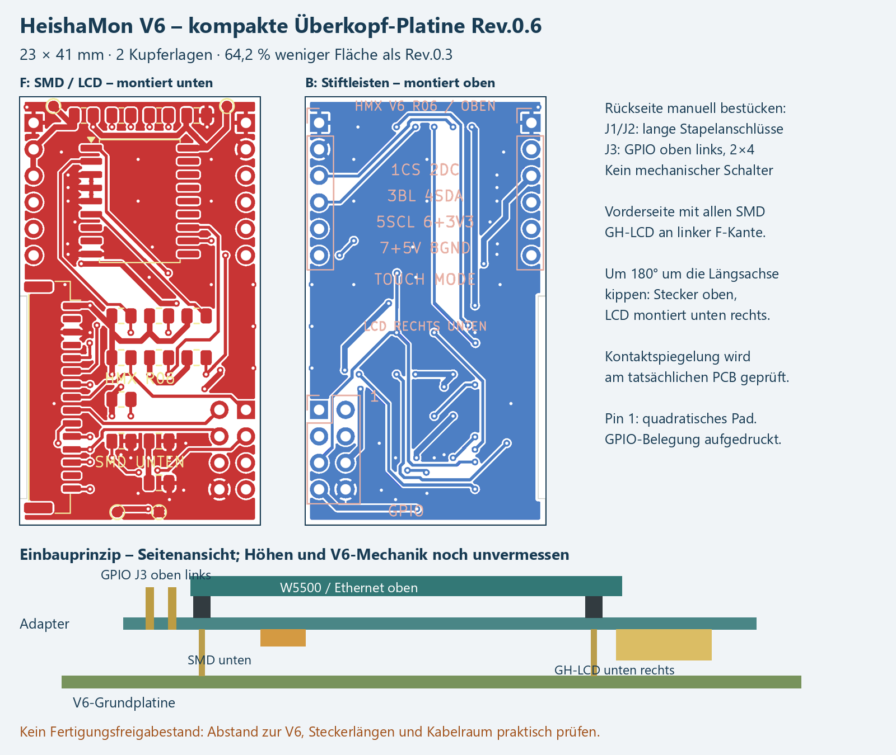

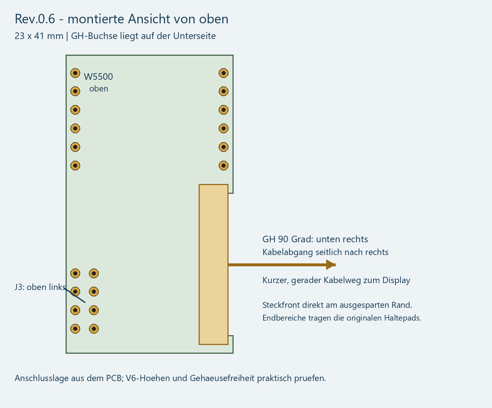

Rev.0.6 versetzt die 15-polige GH-LCD-Buchse J4 auf der F-Seite an die linke Längskante und dreht sie längs. Verwendet wird die 90-Grad-Side-Entry-Bauform: Das Kabel verlässt die Platine seitlich über diese Kante. Die Steckfront der SM-Buchse liegt bei x_F=99,35 mm direkt auf der Kontur einer 0,69 mm tiefen Kantenaussparung im zentralen Steckbereich. An beiden Enden bleibt die Platine bis x_F=98,66 mm stehen, damit die originalen Halte-Lötpads vollständig getragen werden. Die Außenmaße bleiben 23 x 41 mm. Nach dem Überkopf-Einbau liegt sie unten rechts. Die 2x4-GPIO-Stiftleiste J3 sitzt auf der gegenüberliegenden B-Seite rechts am unteren Ende der F-Ansicht; montiert liegt sie oben links. Damit wird eine kurze, gerade Kabelführung zum Display möglich. Die beiden USR-Steckreihen liegen in dieser Revision 2,5 mm näher an der oberen Platinenkante. Damit bleibt die Länge bei 41 mm; die Breite sinkt auf 23 mm. Bei 20,32 mm Reihenabstand beträgt der Rand je 1,34 mm ab Pinmitte bzw. etwa 0,49 mm ab Kupferpad. Die benachbarte V6-2x5-Stiftleiste wird nicht verwendet; ein unnötiger breiter seitlicher Ausleger entfällt.

### JLCPCB-Rendering: Draufsicht

Vom Anwender bereitgestellte JLCPCB-Ansicht der Rev.0.6, Stand 25.10.2026. Sicht auf die SMD-Seite (F.Cu); diese liegt nach der Überkopfmontage unten. Die manuell zu bestückenden Stiftleisten fehlen im Rendering planmäßig.

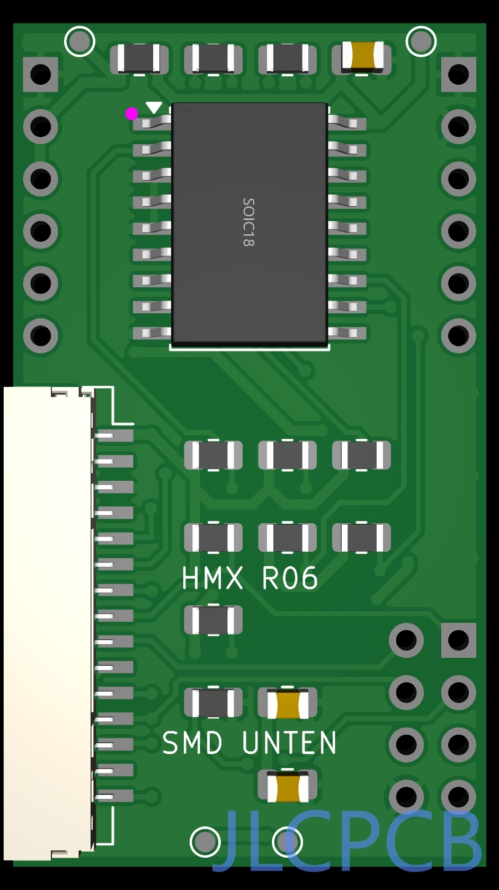

### JLCPCB-Rendering: Perspektive

Perspektivische Ansicht derselben SMD-Seite mit seitlicher GH-Displaybuchse J4 am Platinenrand. Die Ansichten dokumentieren die Bestückungsvorschau; die mechanische Passprobe an V6 und Displaykabel steht weiterhin aus.

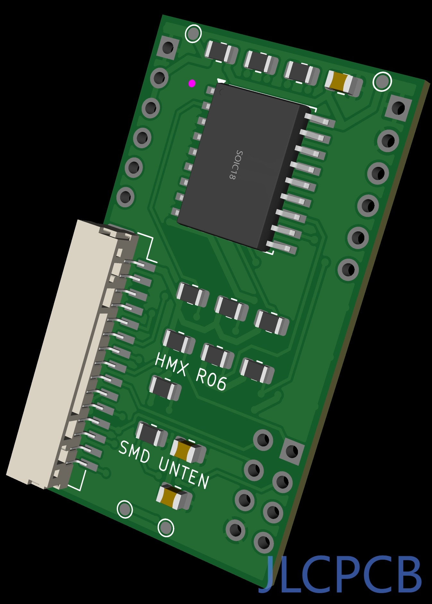

### Displaykabel mit zwei GH-Steckern

Der GH-Anschluss bleibt erhalten. Benötigt wird ein Kabel mit zwei GHR-15V-S-Gehäusen und elektrischer 1:1-Belegung (1 nach 1 bis 15 nach 15). Das mitgelieferte Waveshare-Kabel besitzt nach dem vorliegenden Produktbild nur ein GH-Ende und ersetzt dieses Verbindungskabel nicht. Ohne eigene Crimpzange lässt sich ein Kabel aus zwei Gehäusen und 15 beidseitig vorgecrimpten JST-AGHGH28K152-Einzeladern (152,4 mm) zusammenstecken. Längere Variante: AGHGH28K305 (304,8 mm). Diese Längen beziehen sich auf die separat bestellbaren Adern; die Länge des Waveshare-Beipackkabels ist nicht bestätigt. Vor Anschluss alle Pinnummern durchmessen; nicht nach Farben oder Händlerbegriffen wie reverse gehen.

- Gehäuse: https://www.digikey.de/de/products/detail/jst-sales-america-inc/GHR-15V-S/807827
- 152,4-mm-Adern: https://www.digikey.de/de/products/detail/jst-sales-america-inc/AGHGH28K152/6009449
- 304,8-mm-Adern: https://www.digikey.de/de/products/detail/jst-sales-america-inc/AGHGH28K305/6009450

### Kleinere GPIO-Stiftleiste J3

J3 ist jetzt **2x4 statt 1x8**, bei weiterhin 2,54 mm Raster. Die bisherigen elektrischen Kontaktnummern bleiben erhalten. Ein vorhandenes Kabel für die einreihige Rev.0.3 darf daher nicht mechanisch unverändert übernommen werden.

Die folgende Anordnung gilt beim Blick auf die **montierte obere Steckerseite B**, Pin 1 am quadratischen Pad und der aufgedruckten 1:

| Reihe | Linker Kontakt | Rechter Kontakt |
| --- | --- | --- |
| 1 | 1: LCD_CS / GPIO33 | 2: LCD_DC / GPIO34 |
| 2 | 3: LCD_BL / GPIO35 | 4: SDA / GPIO36 |
| 3 | 5: SCL / GPIO37 | 6: V6-3,3 V |
| 4 | 7: V6-5 V, nur Reserve | 8: GND |

J5, S1 und R4 entfallen. J4 bleibt unverändert 15-polig. Die aufgedruckte GPIO-Kurzbelegung erleichtert die Kontrolle; eine ungeschützte Stiftleiste ist nicht verpolsicher.

### Bestückung, Beschriftung und Prüfung

Die Platine trägt Revision, Markierung der Einbaulage, GPIO-Kurzbelegung, Touch-/LCD-Zuordnung und Pin-1-Kennzeichnung. Pin 1 ist zusätzlich an den quadratischen THT-Pads erkennbar. Die SMD-Passivteile bleiben 0805 und damit von Hand lötbar. Vier zusätzliche Ethernet-Testpads entfallen; die vier Messpunkte für V6-3,3 V, Erweiterungs-3,3 V, 5 V und Masse bleiben erhalten.

Die Netzliste umfasst 21 Netze; 23 Footprints liegen auf der Platine (16 SMD-Teile, drei manuelle Stiftleisten und vier unbestückte Messpunkte). J6/J7 zeigen im Schaltplan die externen Gegenkontakte am W5500-Modul und erhalten keine zusätzlichen PCB-Footprints. Versorgung weiterhin aus der V6 über die herausnehmbare Messbrücke R0; kein zusätzlicher Regler. Die 5-V-Reserve wird nicht mit der 3,3-V-Logik verbunden.

**Geprüfter elektrischer Prototyp:** Das fertige Zweilagen-Routing wird mit mindestens 0,20 mm Kupferabstand, 0,25 mm Signalleitungen, 0,50 mm Versorgungsleitungen und Vias mit 0,60/0,30 mm Kupfer/Bohrung geprüft. Auf beiden Seiten liegen verbundene Masseflächen. ERC und DRC einschließlich offener Verbindungen müssen jeweils null Verstöße ergeben; der zugehörige Bericht liegt im Paket.

### Vor der Fertigungsfreigabe am Original prüfen

Die kleinere Fläche bestätigt noch keine mechanische Passung. Unterseitige LCD-Buchse, eingesteckter Kabelstecker, SMD-Bauteile und Lötstellen benötigen Abstand zur V6. Oberseitig sind Stapelbuchsen, W5500, RJ45-Stecker/Knickschutz und die nach oben zeigenden Stiftleisten gemeinsam zu prüfen. Auch V6-Platinenkante, seitliche 2x5-Leiste und Gehäuse müssen frei bleiben. Der genaue notwendige Abstand wird aus dem vorhandenen V6-Board und dem tatsächlich gewählten Stecker ermittelt; er ist nicht aus einem allgemeinen USR-ES1-Footprint ableitbar.

J1/J2 benötigen geeignete lange Stapel-/Durchsteckanschlüsse für V6 und Ethernetmodul. Die generischen 2,54-mm-Footprints legen das Bohrbild fest und ersetzen keine Auswahl eines konkreten Steckerteils mit bestätigter Gesamthöhe. Bei einem Prototyp zuerst ohne Wärmepumpenanschluss Durchgang, Verpolung und Versorgung prüfen.

Gerber-, Bohr-, BOM- und CPL-Dateien sind als Prototyp-Fertigungsdaten enthalten. Vor Bestellung sind die mechanische Passung und die herstellerseitige Bestückungsvorschau zu prüfen; diese wurden nicht durch einen realen V6-Aufbau bestätigt. KiCad bleibt das gepflegte Originalformat.

### Routing- und Schaltplanbereinigung Rev.0.6

Die elektrische Belegung und die Anschlusspositionen bleiben erhalten. Offene Ausläufe bei MCP_RST und C2, überlappende Rückführungen und unnötige kurze Zwischenstücke wurden entfernt. Pad-Ausleitungen und Verzweigungen sind geometrisch vereinheitlicht; freier Raum wird für kürzere 45-Grad-Verbindungen genutzt. Ein einzelner 45-Grad-Richtungswechsel besitzt einen normalen Innenwinkel von 135 Grad. Der native KiCad-Schaltplan ist in acht Funktionsgruppen gegliedert, die Displaykontakte sind mit ihren Waveshare-Funktionsnamen beschriftet und lokale Netzbeschriftungen zeigen vom Symbol weg.

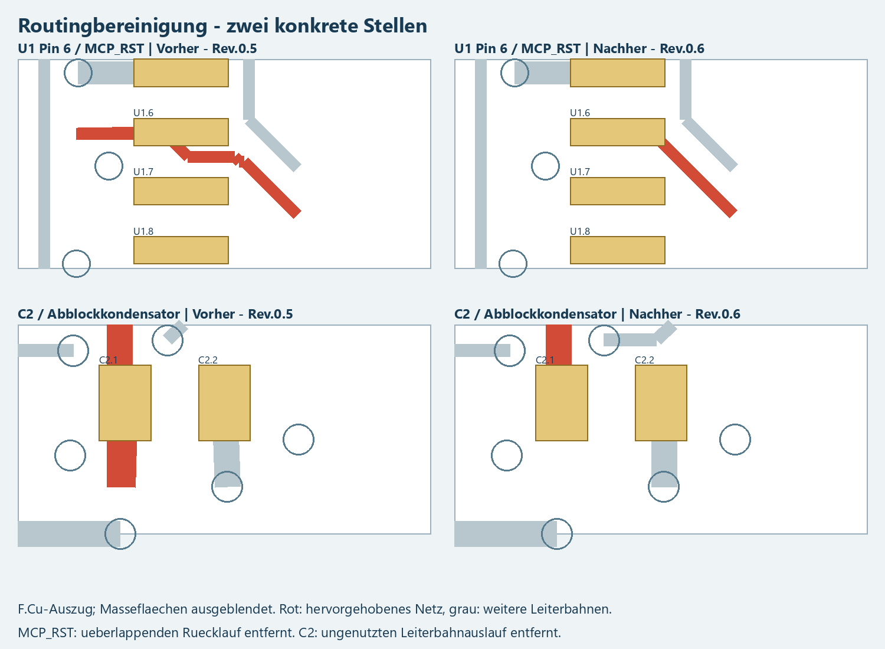

### Reproduktion des finalen Routings

hardware/routed_copper.json enthält die fertige Kupfergeometrie; hardware/routing_order.json die verwendete Routingreihenfolge. tools/design_adapter.py erzeugt bewusst den ungerouteten Ausgangsstand und überschreibt PCB sowie Schaltplan. Für eine Reproduktion zuerst manuelle Änderungen sichern, den Ausgangsstand mit KiCad-Python erzeugen, routed_copper.json nach tmp/ kopieren und tools/pcb_io.py import ausführen. Danach ERC, DRC und Netzliste neu exportieren und tools/check_hardware.py prüfen. Nicht nur den Ausgangsgenerator auf einem fertigen Layout ausführen.

## 22. JLCPCB-Fertigungsdaten und Verfügbarkeit


Stand: 25.10.2026. Prototyp: mechanische V6-Passung und Funktion noch nicht am realen Aufbau bestätigt.

### Dateien für den Upload

Zusätzlich zum vollständigen Paket stehen im Ausgabeordner einzeln bereit: Gerber_HeishaMon_V6_Rev06.zip (ausschließlich Gerber, Bohrdaten und Gerber-Jobdatei), BOM_HeishaMon_V6_Rev06.csv und CPL_HeishaMon_V6_Rev06.csv. Die Fertigungs-ZIP enthält keine BOM, Placement-Datei, PDF oder Vorschau.

- Gerber_HeishaMon_V6_Rev06.zip: Platinenlagen und PTH-/NPTH-Bohrdaten. Nur dieses innere ZIP als Gerberdatei verwenden.
- BOM_JLCPCB.csv: 9 Bauteilgruppen / 16 SMD-Teile, mit geprüften JLC-/LCSC-Nummern.
- CPL_JLCPCB.csv: dieselben 16 Bauteile, Positionen in mm und Rotationen.
- Manual_Parts_NOT_IN_ASSEMBLY.csv: J1/J2/J3 für die spätere manuelle Bestückung; nicht als JLC-BOM hochladen.

Die 20 Bohrungen und Lötpads der manuellen Steckleisten bleiben in den Gerbern und Bohrdateien. Sie fehlen ausschließlich in der automatischen BOM/CPL. Unbestückte Testpunkte und die im Schaltplan extern dargestellten W5500-Gegenkontakte J6/J7 sind ebenfalls nicht Teil der Bestückungsliste. Schalter, J5 und R4 sind entfernt.

### Bestellvorgaben

23 x 41 mm, FR4, zwei Kupferlagen, 1,6 mm Dicke, 1 oz Kupfer. Eine Bestückungsseite: **Top/F**. Im eingebauten Zustand liegt diese Seite durch das Umdrehen unten! Für die Werksbestückung deshalb nicht versehentlich Bottom auswählen. Die manuell zu bestückende B-Seite benötigt keine JLC-Bestückung.

Für kleine Stückzahlen passt die Einzelplatine größenmäßig zu Economic PCBA (laut aktueller JLC-Tabelle ab 10 x 10 mm). Grün, bleifreies HASL beziehungsweise ENIG nach den im Bestellformular angebotenen Economic-Optionen wählen. Standard PCBA verlangt größere Einzelplatinen bzw. Panels; deshalb nicht ohne Prüfung darauf wechseln.

Das kompakte Layout hat an einigen Randstellen weniger als 2,5 mm Gehäuseabstand. Die JLC-DFM-Prüfung muss dies berücksichtigen; nötigenfalls temporäre Fertigungsstege/Panelisierung durch JLC vorsehen, damit die finale Endkontur klein bleibt. JLC nennt für Economic keine zwingenden separaten Fiducials/Rails, weist in den allgemeinen Montagebedingungen aber auf Randabstände und automatische Fertigungsergänzungen hin. Keine zusätzlichen Löcher unkontrolliert in die bestückte Endkontur setzen lassen.

### Koordinaten und Orientierung

Gerber, Bohrung und Placement verwenden denselben Exportursprung an der linken unteren Platinenecke. Im PCB ist das KiCad (98,66 / 136) mm, exportiert (0 / 0). Die Endkontur reicht von 0 bis 23 mm in X und 0 bis 41 mm in Y. Die CAD-Koordinaten sind keine Abstände vom V6-Platinenrand.

U1 erhält die SOIC-Korrektur +270 Grad nach der aktuellen Standardregel des Fabrication Toolkit. Die LCD-Buchse J4 ist die abgewinkelte Side-Entry-Version SM15B-GHS-TB(LF)(SN), JLC C265027. Sie steht in KiCad bei 270 Grad (gleichbedeutend mit -90 Grad). **Korrektur nach Nutzerprüfung der JLCPCB-3D-Vorschau: Für C265027 entfällt die allgemeine JST_GH_SM-Korrektur +180 Grad; die CPL enthält jetzt 270 Grad statt zuvor 90 Grad.** Mit dem bisherigen Wert zeigte die Öffnung laut Nutzer zum Platineninneren. Die korrigierte Ausrichtung muss in der JLC-Vorschau erneut mit Pin 1 und den Haltepads verglichen werden; sie wurde hier nicht im Bestellprojekt überprüft. Der Kabelabgang weist parallel zur Platine seitlich nach links aus der F-Ansicht, montiert also nach rechts. Rotation_Audit.csv zeigt jede Umrechnung. Vor Freigabe in der JLC-Bestückungsvorschau besonders Pin 1 von U1 und J4 sowie die Richtung der LCD-Buchse mit der KiCad-/Bestückungszeichnung vergleichen. Keine automatische Bauteilsubstitution mit anderem Gehäuse akzeptieren.

Diese Dateien wurden erzeugt und lokal auf Konsistenz geprüft. Es wurde kein CAD-/BOM-Upload und keine Bestellung bei JLC ausgeführt.

### Aktuell geprüfte Verfügbarkeit

Die Bestände wurden am 25.10.2026 direkt in der öffentlichen JLCPCB-Oberfläche abgelesen, ohne Anmeldung und ohne Teile zu reservieren. Lagerbestand und bestellbare Menge können sich ändern. Bei U1 war im Suchergebnis ein Bestand angegeben; keine separate bestellbare Menge wurde übernommen.

| Funktion / Referenzen | JLC-Nummer | Hersteller-Teilenummer | Lagerbestand |
| --- | --- | --- | --- |
| R0 | [C17477](https://jlcpcb.com/partdetail/0805W8F0000T5E/C17477) | 0805W8F0000T5E | 5.499.786 |
| R1, R2 | [C17673](https://jlcpcb.com/partdetail/0805W8F4701T5E/C17673) | 0805W8F4701T5E | 4.744.060 |
| R3, R5, R6, R7, R10 | [C17414](https://jlcpcb.com/partdetail/0805W8F1002T5E/C17414) | 0805W8F1002T5E | 54.247.168 |
| R8, R9 | [C17634](https://jlcpcb.com/partdetail/0805W8F330JT5E/C17634) | 0805W8F330JT5E | 1.362.580 |
| R11 | [C149504](https://jlcpcb.com/partdetail/0805W8F1003T5E/C149504) | 0805W8F1003T5E | 3.367.825 |
| C1, C2 | [C49678](https://jlcpcb.com/partdetail/CC0805KRX7R9BB104/C49678) | CC0805KRX7R9BB104 | 22.465.473 |
| C3 | [C15850](https://jlcpcb.com/partdetail/CL21A106KAYNNNE/C15850) | CL21A106KAYNNNE | 9.133.237 |
| U1 | [C92253](https://jlcpcb.com/partdetail/MicrochipTech-MCP23008_ESO/C92253) | MCP23008-E/SO | 442 |
| J4 | [C265027](https://jlcpcb.com/partdetail/JST-SM15B_GHS_TB_LF_SN/C265027) | SM15B-GHS-TB(LF)(SN) | 480 |

Alle primär ausgewählten Typen waren vorrätig. Es sind daher keine Ersatztypen in die BOM eingetragen.

### Geprüfte Alternativen

- Für C17673: [C407444 – 0805W8D4701T5E](https://jlcpcb.com/partdetail/396001-0805W8D4701T5E/C407444), Bestand 4.980. Gleicher Nennwert/Bauform, engere Toleranz; geeignete Alternative.
- Für C17414: [C84376 – RC0805FR-0710KL](https://jlcpcb.com/partdetail/RC0805FR-0710KL/C84376), Bestand 1.796.974. Gleicher Nennwert, Leistung und Bauform.
- Für C149504: [C96346 – RC0805FR-07100KL](https://jlcpcb.com/partdetail/YAGEO-RC0805FR07100KL/C96346), Bestand 1.509.081. Gleicher Nennwert, Leistung und Bauform.
- Für C17414: [C38522 – 0805W8F1002T5E](https://jlcpcb.com/partdetail/39505-0805W8F1002T5E/C38522), Bestand 0. Aktuell nicht vorrätig; deshalb nicht in der BOM.
- Für C149504: [C17407 – 0805W8F1003T5E SMTonly](https://jlcpcb.com/partdetail/18095-0805W8F1003T5E_SMT/C17407), Bestand 0. Aktuell nicht vorrätig; stattdessen C149504 ausgewählt.

MCP23008T-E/SO wäre die Tape-and-Reel-Ausführung desselben SOIC-18-Bausteins. Eine zusätzliche JLC-Bestandsposition dafür wurde nicht bestätigt. Bei späterem Engpass zuerst C92253 vorbestellen bzw. den identischen SOIC-18-Typ beschaffen lassen. MCP23008 in SSOP-20/QFN-20, MCP23S08 und PCF8574 sind keine direkten Ersatzteile für dieses Layout bzw. diese Firmware.

### Weitere Unterlagen

BOM_Detail.csv enthält Stückzahlen und Spezifikationen, Availability_2026-10-25.csv die abgelesenen Mengen und Quellen, Alternatives.csv die Ersatzteilliste. export_validation.json dokumentiert Dateikonsistenz, Ursprung, Maße, Ausschlüsse und SHA-256 der exportierten PCB. KiCad_SMD_positions.csv ist der unveränderte Ausgangsexport zur Nachvollziehbarkeit.

### Herstellerquellen

- [JLCPCB BOM/CPL aus KiCad 10](https://jlcpcb.com/help/article/how-to-generate-the-bom-and-centroid-file-from-kicad)
- [JLCPCB Assembly Capabilities](https://jlcpcb.com/capabilities/pcb-assembly-capabilities)
- [JLCPCB Montagebedingungen und Randabstände](https://jlcpcb.com/help/article/terms-and-conditions-of-jlcpcb-assembly-service)
- [JLCPCB Panelisierung](https://jlcpcb.com/help/article/pcb-panelization)
- [Rotationen: Fabrication Toolkit](https://github.com/bennymeg/Fabrication-Toolkit/blob/master/plugins/transformations.csv), Blob 40878ad04b8f0ac427e48085c2440ea26bbd99a9.


## 23. Projektaufbau

Quellen liegen in extension/ und firmware/, KiCad in hardware/, Fertigungsdaten in manufacturing/JLCPCB/Rev06/, Dokumentation in docs/, die aktuellen Downloadpakete in output/. Historische Entwürfe liegen getrennt in archive/. Flüchtige Build- und Renderdateien werden nicht als aktuelle Ergebnisse behandelt. README.md ist der Einstiegspunkt.

## Anhang A. Vollständige Verbindungsliste

Jeder Eintrag bezeichnet **Bauteilreferenz.Kontaktnummer** des neuen Adapters. Alle Punkte einer Zeile sind elektrisch verbunden. Die Netzliste wurde unabhängig für die Platinenbauteile mit dem KiCad-Export abgeglichen. J6/J7 zeigen die externen Gegenkontakte des W5500-Moduls; diese erhalten keinen zusätzlichen PCB-Footprint.

| Netz | Sämtliche Anschlusspunkte |
| --- | --- |
| +3V3_EXT | C1.1, C2.1, C3.1, J4.1, R0.2, R1.1, R10.1, R2.1, R3.1, R5.1, R6.1, R7.1, TP2.1, U1.18 |
| +3V3_V6 | J2.2, J2.3, J3.6, J7.2, J7.3, R0.1, TP1.1 |
| +5V_V6 | J3.7, TP3.1 |
| ETH_CS | J1.5, J6.5 |
| ETH_IRQ | J1.6, J6.6 |
| ETH_RST | J2.5, J7.5 |
| GND | C1.2, C2.2, C3.2, J1.1, J1.2, J2.1, J3.8, J4.3, J6.1, J6.2, J7.1, R11.2, TP4.1, U1.3, U1.4, U1.5, U1.9 |
| I2C_SCL | J3.5, J4.13, R2.2, U1.1 |
| I2C_SDA | J3.4, J4.12, R1.2, U1.2 |
| LCD_BL | J3.3, J4.11, R11.1 |
| LCD_CS | J3.1, J4.8, R5.2 |
| LCD_DC | J3.2, J4.9 |
| LCD_MOSI | J4.5, R8.2 |
| LCD_RST | J4.10, R6.2, U1.12 |
| LCD_SCK | J4.6, R9.2 |
| MCP_RST | R3.2, U1.6 |
| SD_CS | J4.7, R10.2 |
| SPI_MISO | J2.6, J7.6 |
| SPI_MOSI | J1.3, J6.3, R8.1 |
| SPI_SCK | J1.4, J6.4, R9.1 |
| TP_RST | J4.15, R7.2, U1.11 |

Bewusst unbeschaltet: J2.4, J4.2, J4.4, J4.14, U1.7, U1.8, U1.10, U1.13, U1.14, U1.15, U1.16, U1.17, J7.4. J6/J7 liegen extern am Ethernetmodul.

**Prüfstand:** ERC 0 Verstöße; Geroutete Platine 0 DRC-Verstöße; 0 offene Verbindungen. Mechanische Passung und Hardwaretest stehen aus; keine Fertigungsfreigabe.


Herstellerreferenz USR-ES1: https://www.pusr.com/download/ES1/USR-ES1-EN%20V1.3.pdf
