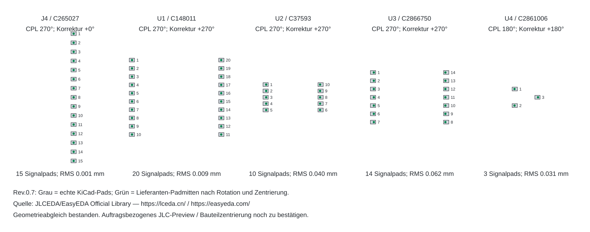

# Rev.0.7 – Bestellprüfung vom 30.10.2026

Die lokale Entwurfsprüfung und der aktuelle Lieferantenabgleich sind durchgeführt. Ein physischer Aufbau war nicht verfügbar. Hersteller-Preview und reale V6-Passform sind noch nicht bestätigt; es besteht keine Fertigungsfreigabe.

## Behobene Befunde

- **U4-Rotation:** statt CPL 0° jetzt **180°**, aus allen drei nummerierten Lieferanten-Pads ermittelt. U1/U2/U3 bleiben 270°, J4 bleibt 270°.
- **R15/R19/R23/R27:** statt 1 MΩ jetzt **100 kΩ, 0,1 %, 0603**, Yageo RT0603BRD07100KL / C122538. Das TMUX1511-Datenblatt nennt bis zu 2 µA Powered-off-Leckstrom. Konservativ vollständig am ADC angesetzt ergäben 1 MΩ bis zu 2,002 V; 100 kΩ begrenzen dies rechnerisch auf 0,2002 V. Der quasistatische Nachweis ersetzt keine Messung beim Ein-/Ausschalten.
- Footprints, Steckerpositionen, Endkontur und gespeicherte Kupfergeometrie bleiben erhalten. Schaltplan, BOM und Umrechnungsfaktoren sind aktualisiert.

## Teileverfügbarkeit

Direkte JLCPCB-API-Abfrage, UTC-Zeit pro Position in `stock_snapshot.json`. Keine Reservierung. Die angegebene bestellbare Menge ist nicht nur der Lagerbestand; auftragsbezogenen Teilezuschlag und Mindestmengen in der Kalkulation berücksichtigen. Drei manuelle Steckleisten sind nicht Teil dieser SMD-Prüfung.

| Referenzen | JLC-Nummer | MPN | Bestellbare Stück |
| --- | --- | --- | ---: |
| R0 | [C17477](https://jlcpcb.com/api/overseas-pcb-order/v1/smtComponentShopCart/getComponentDetail?componentCode=C17477) | 0805W8F0000T5E | 4438883 |
| R1, R2 | [C17673](https://jlcpcb.com/api/overseas-pcb-order/v1/smtComponentShopCart/getComponentDetail?componentCode=C17673) | 0805W8F4701T5E | 3513501 |
| R3, R5, R6, R7, R10 | [C17414](https://jlcpcb.com/api/overseas-pcb-order/v1/smtComponentShopCart/getComponentDetail?componentCode=C17414) | 0805W8F1002T5E | 49411862 |
| R8, R9 | [C17634](https://jlcpcb.com/api/overseas-pcb-order/v1/smtComponentShopCart/getComponentDetail?componentCode=C17634) | 0805W8F330JT5E | 1229611 |
| R11 | [C149504](https://jlcpcb.com/api/overseas-pcb-order/v1/smtComponentShopCart/getComponentDetail?componentCode=C149504) | 0805W8F1003T5E | 2647452 |
| C1, C2 | [C49678](https://jlcpcb.com/api/overseas-pcb-order/v1/smtComponentShopCart/getComponentDetail?componentCode=C49678) | CC0805KRX7R9BB104 | 19407642 |
| C3 | [C15850](https://jlcpcb.com/api/overseas-pcb-order/v1/smtComponentShopCart/getComponentDetail?componentCode=C15850) | CL21A106KAYNNNE | 6638084 |
| J4 | [C265027](https://jlcpcb.com/api/overseas-pcb-order/v1/smtComponentShopCart/getComponentDetail?componentCode=C265027) | SM15B-GHS-TB(LF)(SN) | 13220 |
| U1 | [C148011](https://jlcpcb.com/api/overseas-pcb-order/v1/smtComponentShopCart/getComponentDetail?componentCode=C148011) | MCP23008-E/SS | 143 |
| U2 | [C37593](https://jlcpcb.com/api/overseas-pcb-order/v1/smtComponentShopCart/getComponentDetail?componentCode=C37593) | ADS1115IDGSR | 12069 |
| U3 | [C2866750](https://jlcpcb.com/api/overseas-pcb-order/v1/smtComponentShopCart/getComponentDetail?componentCode=C2866750) | TMUX1511PWR | 2006 |
| U4 | [C2861006](https://jlcpcb.com/api/overseas-pcb-order/v1/smtComponentShopCart/getComponentDetail?componentCode=C2861006) | TLV809EA29DCKR | 20 |
| R12, R13, R16, R17, R21, R25 | [C95204](https://jlcpcb.com/api/overseas-pcb-order/v1/smtComponentShopCart/getComponentDetail?componentCode=C95204) | RT0603BRD0710KL | 1113119 |
| R20 | [C723637](https://jlcpcb.com/api/overseas-pcb-order/v1/smtComponentShopCart/getComponentDetail?componentCode=C723637) | RT0603BRD0720KL | 489 |
| R24 | [C705793](https://jlcpcb.com/api/overseas-pcb-order/v1/smtComponentShopCart/getComponentDetail?componentCode=C705793) | RT0603BRD0768KL | 15893 |
| R14, R18, R22, R26 | [C110776](https://jlcpcb.com/api/overseas-pcb-order/v1/smtComponentShopCart/getComponentDetail?componentCode=C110776) | RT0603BRD071KL | 1326219 |
| R15, R19, R23, R27 | [C122538](https://jlcpcb.com/api/overseas-pcb-order/v1/smtComponentShopCart/getComponentDetail?componentCode=C122538) | RT0603BRD07100KL | 1194123 |
| C4, C5, C6, C7, C8, C9, C10 | [C1591](https://jlcpcb.com/api/overseas-pcb-order/v1/smtComponentShopCart/getComponentDetail?componentCode=C1591) | CL10B104KB8NNNC | 3664061 |

Engpass: U4 / C2861006, 20 Stück. Das entspricht rechnerisch 20 Platinen vor eventuellen Fertigungszuschlägen; keine Lieferzusage.

## Bestückungsorientierung

Quelle: **JLCEDA/EasyEDA Official Library**, [JLCEDA](https://lceda.cn/) / [EasyEDA](https://easyeda.com/). Alle nummerierten Pads der konkreten Lieferantenteile wurden gegen die echten KiCad-Pads verglichen; bei J4 zusätzlich die Seite der Haltepads. Widerstände und MLCC sind ungepolt.

| Referenz | KiCad | Korrektur | CPL | Geprüfte Signalpads |
| --- | ---: | ---: | ---: | ---: |
| J4 | 270° | +0° | 270° | 15 |
| U1 | 0° | +270° | 270° | 20 |
| U2 | 0° | +270° | 270° | 10 |
| U3 | 0° | +270° | 270° | 14 |
| U4 | 0° | +180° | 180° | 3 |

`assembly_orientation_audit.json` dokumentiert die Rechenprüfung. Der kleine Restfehler stammt unter anderem aus unterschiedlichen Landpatterns. Die Zentrierung in der Vergleichsgrafik ist **kein** automatisch angewendeter CPL-Positionsversatz. Bei J4 unterscheiden sich die Referenzen um etwa 0,375 mm quer zur Signalpadreihe; Haltepad-Landpatterns weichen ebenfalls ab. Deshalb im Auftrags-Preview sowohl Signalpads als auch Haltepads und nach außen gerichtete Kabelöffnung prüfen. Eine generische Korrektur um +180° für J4 wäre hier falsch.

Das öffentliche Bibliotheksmodell ist kein Nachweis des konkreten Bestückautomaten-Modells. Die REVIEW-Dateinamen bleiben bis zur Sichtprüfung im auftragsbezogenen JLC-Preview erhalten. Noch kein Upload und keine Bestellung ausgeführt.

## Elektrische und geometrische Entwurfsprüfung

ERC **0**, DRC **0**, offene Verbindungen **0**. 35 Netze gegen echte PCB-Pads geprüft. 51 Footprints, 42 SMD-Referenzen in BOM/CPL, 835 Leiterbahnsegmente und 79 Vias. Steckerpositionen identisch zu Rev.0.6; Kontur 23 × 41 mm / zwei Lagen.

ADS1115: VSSOP-10, 0x48; MCP23008: SSOP-20, 0x20; Touch: 0x38. ADS/TMUX/Supervisor-Pinbelegungen sind explizit im unabhängigen Prüfskript kontrolliert. GP0 bleibt Eingang: die aktuelle dev.7 konfiguriert nur GP1/GP2 als Ausgänge. Künftige ADC-Firmware darf GP0 nicht gegen den Supervisor treiben.

| Kanal | Quelle nominal | ADC nominal | Faktor Quelle/ADC | ADC maximal im vorgesehenen Bereich | Teilerstrom nominal |
| --- | ---: | ---: | ---: | ---: | ---: |
| AIN0 / +3V3_V6 | 3.3 V | 1.5566 V | 2.120040 | 1.6999 V | 172.8 µA |
| AIN1 / +3V3_EXT | 3.3 V | 1.5566 V | 2.120040 | 1.6999 V | 172.8 µA |
| AIN2 / +5V_V6 | 5 V | 1.5480 V | 3.230060 | 1.7052 V | 171.8 µA |
| AIN3 / +12V_SENSE | 12 V | 1.4022 V | 8.558156 | 2.1070 V | 155.6 µA |

Die Rechnung berücksichtigt unabhängige ±0,1-%-Widerstandstoleranzen und die zusätzliche Belastung durch 1 kΩ/100 kΩ. Höchste Spannung am offenen TMUX-Eingang: 2,312 V bei 18 V an TP5; damit unter 3,6 V Powered-off-Grenze. Konservative obere Schranke der Leistung des obersten Teilerwiderstands: unter 4,8 mW gegenüber 100 mW Nennleistung. Unbelastete Filterzeitkonstanten: 0,50 / 0,50 / 0,67 / 0,87 ms.

Die beiden 3,3-V-Teiler belasten dieselbe Ursprungsversorgung gemeinsam mit rund 346 µA. Dazu kommen ADC, Schalter, Supervisor und die bestehende Display-/Touch-/Ethernet-Last; eine ausreichende V6-Reglerreserve ist daraus nicht nachgewiesen. Der ADC-Eingang ist dynamisch, daher sind die Faktoren Startwerte für den Multimeterabgleich. Die neue dev.7 enthält noch keine ADC-Auswertung.

## Vor Bestellung am vorhandenen V6-Board prüfen

1. **Passform, spannungslos:** `V6_Passschablone_1zu1.svg` mit 100 % drucken, 50-mm-Kontrollstrecke nachmessen. J1/J2: 2,54-mm-Raster, 20,32-mm-Reihenabstand; J3: 2×4, genaue Lage am Board prüfen. Stecker nicht unter Kraft zusammenstecken.
2. **Kontakte:** `V6_Kontaktpruefung.csv` enthält alle 20 Sollkontakte aus den tatsächlichen PCB-Pads und Leerfelder für Istbelegung/Messwerte. Jede 3,3-V-/5-V-/GND-Verbindung am konkreten V6 abgleichen, NC nicht verbinden. Signalnetze durch Schaltplan/Leiterbahnverfolgung zuordnen; eine Spannungsmessung allein identifiziert keinen GPIO.
3. **Stapelhöhe:** tatsächliche W5500-, Displaystecker- und Kabelhöhen messen; dann konkrete lange Durchsteck-/Stapelkontakte J1/J2 auswählen. Die generischen KiCad-Stiftleisten bestimmen keine kaufbare Bauhöhe. Kein Kontakt zu Bauteilkörpern, Lötstellen oder Kabelsteckern; für den Prototyp mindestens 1 mm freie mechanische Reserve vorsehen.
4. **12 V:** positiven 12-V-Abgriff, gemeinsame Masse und Maximalspannung am Gerät bestimmen. Bei gemeinsamer V6-/Adaptermasse genügt eine zusätzliche Leitung vom 12-V-Abgriff zu TP5; GND besteht bereits über die Steckkontakte. TP6 ist nur ein optionaler GND-Löt-/Prüfpunkt, etwa für das Multimeter oder einen separaten Prüfaufbau ohne bestehende Masseverbindung. Eine zusätzliche Masseleitung ist im normalen V6-Aufbau nicht erforderlich.

`PCB_3D_Pruefansicht.png` ist eine unvollständige lokale Bestückungsansicht: Für J4 fehlt das native KiCad-3D-Modell, die manuellen Stapelkontakte sind generische Modelle. Weder V6 noch W5500 sind als vermessene Gegenbaugruppe enthalten. Diese Ansicht bestätigt keine Stapelhöhen oder Kabelpassform.

## Hardwareprüfung am ersten Rev.0.7-Prototyp

Diese Prüfungen benötigen eine gefertigte Platine, Labornetzteil, Multimeter und für Versorgungstransienten ein Oszilloskop. Ergebnis bisher jeweils **nicht durchgeführt**.

| Schritt | Durchführung / Soll | Ergebnis |
| --- | --- | --- |
| Sichtkontrolle | IC-Markierung/Pin 1 und U4-180° mit Bestückungsplan vergleichen; keine Brücken an 0,5-/0,65-mm-Pins. | Offen |
| Durchgang, spannungslos | Alle Kontakte anhand Verbindungsmatrix prüfen. Kein harter Kurzschluss zwischen Versorgungen und GND; Ladung von Kondensatoren berücksichtigen. | Offen |
| Versorgung ohne V6/Display | Adapter separat mit 3,3 V und zunächst 20 mA Strombegrenzung versorgen, TP5 offen. Bei Begrenzung/Erwärmung abbrechen und Ursache suchen. Erst danach 5 V am vorgesehenen Kontakt zuführen; nie 5 V auf 3,3 V. | Offen |
| I²C / GP0 | 0x20 und 0x48 antworten; GP0 an stabilen 3,3 V High. Touchadresse 0x38 erst mit angeschlossenem Display erwarten. | Offen |
| Teiler | Bei 3,3/3,3/5/12 V ungefähr 1,557/1,557/1,548/1,402 V an AIN0..3; gegen GND messen. Zunächst ±1 % als Aufbaukontrolle, danach ADC kalibrieren. | Offen |
| 12-V-Kanal | Am vom V6 getrennten Adapter 0/6/12/18 V positiv an TP5 durchfahren; AIN3 bei 18 V nominal ca. 2,103 V. | Offen |
| Ein-/Ausschalten | 12 V an TP5, EXT-Versorgung aus; AIN-Pins statisch unter 0,3 V. Ein-/Ausschaltkurven mit Oszilloskop prüfen: kein AIN > momentanes VDD+0,3 V; keine Rückspeisung. | Offen |
| Unterspannung | EXT langsam um 2,93 V durchfahren; ADC_ENABLE/GP0 muss entsprechend Datenblatt aus-/einschalten, Verzögerung und Hysterese berücksichtigen. Schnelle Versorgungseinbrüche zusätzlich prüfen. | Offen |
| Vollaufbau | Displayhelligkeit maximal, Ethernet aktiv, Touch/Reset testen; 3,3/5 V an Quelle und Adapter beobachten, Strom-/Temperaturgrenzen des realen V6-Reglers einhalten. | Offen |
| Messgenauigkeit | Vier Kanäle gegen Referenzmultimeter an mehreren Spannungen abgleichen; nach Aufwärmen wiederholen. Ziel für Versorgungskontrolle festlegen, z. B. ±1 % nach Abgleich. | Offen |

Vor den I²C-/ADC-Funktionstests ist eine passende Diagnose-/ADC-Firmware nötig. Die bestehende Rev.0.6-dev.7-Datei prüft den ADS1115 nicht. Ohne erfolgreich gemessene Ergebnisse bleiben `hardware_tested` und `manufacturing_release` auf `false`.

## Auftragsbezogene Herstellerprüfung

Nur `Gerber_HeishaMon_V6_Rev07_PROTOTYPE.zip`, `BOM_JLCPCB_REVIEW.csv` und `CPL_JLCPCB_REVIEW.csv` aus `manufacturing/JLCPCB/Rev07/` verwenden. 23×41 mm, zwei Lagen, 1,6 mm, 1 oz, Bestückung Top/F. Das spätere Überkopf-Montieren ist kein Grund, Bottom zu bestellen.

Im Preview: 42 SMD-Referenzen/18 Typen, keine J1/J2/J3/TP-Bestückung, U1/U2/U3/J4 CPL270, U4 CPL180. Pin 1 aller ICs und J4-Padüberdeckung/Kabelöffnung kontrollieren. Wegen der kompakten Endkontur erforderliche Fertigungsstege/Panelisierung durch den Fertiger prüfen lassen; Endkontur nicht vergrößern. Keine automatische Gehäuse-/Bauteilsubstitution.

## Reproduzierbare Prüfungen

1. `fetch_voltage_monitor_parts.py` mit Netzwerkzugriff aktualisiert den vollständigen JLC-Bestand und die fünf Lieferanten-Padbelegungen.
2. KiCad ERC/DRC/XML-Netzliste erzeugen; `check_voltage_monitor.py` prüft Netze, Pinbelegung und Mess-/Schutzrechnung.
3. `review_voltage_monitor_assembly.py` berechnet die Rotationen; `export_voltage_monitor.py` exportiert BOM/CPL/Gerber.
4. `review_voltage_monitor_assembly.py --check-cpl` prüft die tatsächliche CPL; `review_voltage_monitor_hardware.py` aktualisiert diesen Bericht und die Kontakt-Prüfvorlage.
5. `verify_reproduction.py --voltage` prüft Quelle plus gespeicherte Kupfergeometrie; `package_voltage_monitor.py` erstellt das aktualisierte Paket.

## Primärquellen

- [TMUX1511, elektrische Kennwerte und Powered-off-Schutz](https://www.ti.com/lit/ds/symlink/tmux1511.pdf), insbesondere IPOFF bis ±2 µA über den spezifizierten Temperaturbereich.
- [TLV809E, DCK-Pinbelegung und 2,93-V-Ausführung](https://www.ti.com/lit/ds/symlink/tlv803e.pdf).
- [ADS1115, VSSOP-10-Pinbelegung und Eingangsbeschaltung](https://www.ti.com/lit/ds/symlink/ads1115.pdf).
- [MCP23008, Microchip-Datenblatt](https://ww1.microchip.com/downloads/en/DeviceDoc/MCP23008-MCP23S08-Data-Sheet-20001919F.pdf).
- [JLCPCB Fertigungsgrenzen](https://jlcpcb.com/capabilities/pcb-capabilities/).
